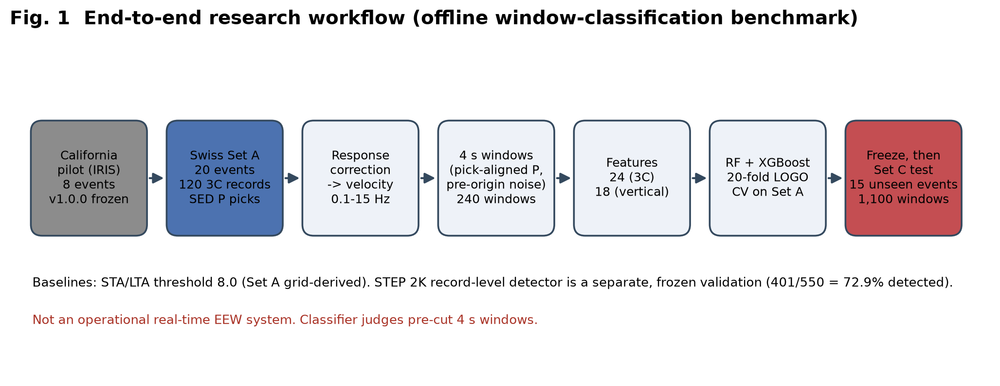

# AMGCR Earthquake Research

Reproducible **AI-assisted Earthquake Early Warning (EEW)** research for **Western seismic regions**, developed in the context of a **Swiss certificate programme**.

**Release:** **v1.0.0 — Submission Release** (29 July 2026) · [RELEASE_SUMMARY_v1.0.md](RELEASE_SUMMARY_v1.0.md)

## For academic reviewers (start here)

**Read first:** [Website navigation guide](docs/professor_handover/WEBSITE_NAVIGATION_GUIDE.md) · [docs/professor_handover/PROFESSOR_HANDOVER_GUIDE.md](docs/professor_handover/PROFESSOR_HANDOVER_GUIDE.md) · [Executive summary](docs/professor_handover/RESEARCH_EXECUTIVE_SUMMARY.md) · [Review checklist](docs/professor_handover/PROFESSOR_REVIEW_CHECKLIST.md) · [Limitations and open questions](docs/professor_handover/RESEARCH_LIMITATIONS_AND_OPEN_QUESTIONS.md)

**What this is.** An **offline P-wave versus ambient-noise window-classification research benchmark**. Random Forest and XGBoost trained on 20 Swiss earthquakes (Set A) are evaluated on 15 different earthquakes (Set C) and compared with an STA/LTA threshold rule. It is **not** an operational real-time early-warning system and not earthquake prediction.

**Objective.** A reproducible workflow from public waveform services (USGS, EarthScope/IRIS, SED/ETH) to labelled 4 s windows, features and event-grouped evaluation, with limitations stated.



| Dataset | Provider | Events | Records | Stations | Channels | Manual picks | Windows | Features |
|---|---|---|---|---|---|---|---|---|
| California pilot (v1.0.0, frozen) | USGS + EarthScope | 8 | 8 (manifest) | 2 | CI BHZ | none (STA/LTA triggers) | n/a | 18 |
| Swiss Set A | SED/ETH | 20 | 120 | 54 | HHZ, HHN, HHE | 120 | 240 | 24 |
| Swiss Set C | SED/ETH | 15 | 550 | 79 | HHZ | 550 | 1,100 | 18 |

**Main result (saved JSON, Set C, 15 unseen events).** XGBoost F1 0.9169 (recall 0.8527), Random Forest F1 0.9125 (recall 0.8436), window-level STA/LTA baseline F1 0.5014 (recall 0.3345). The baseline is not the STEP 2K record-level detector (401 of 550 records detected). Details: [docs/SET_C_VERTICAL_ML_EVALUATION_REPORT.md](docs/SET_C_VERTICAL_ML_EVALUATION_REPORT.md).

**Website.** https://amgcr-research.vercel.app/ (live deployment status not verified for the latest commit). Source in [`website/`](website/); pages `/data-analysis` (Data Collection & Analysis) and `/ml-evaluation` (ML Evaluation) are built from this repository.

| Need | Document |
|---|---|
| Data journey and sources | [docs/DATA_COLLECTION_AND_ANALYSIS_REPORT.md](docs/DATA_COLLECTION_AND_ANALYSIS_REPORT.md) |
| Columns and features | [docs/DATA_DICTIONARY.md](docs/DATA_DICTIONARY.md) |
| Reproduce data and features | [docs/DATA_ACQUISITION_AND_REPRODUCTION.md](docs/DATA_ACQUISITION_AND_REPRODUCTION.md) |
| Reproduce / verify models | [docs/ML_REPRODUCTION_GUIDE.md](docs/ML_REPRODUCTION_GUIDE.md) |
| Files, models and paths | [docs/DATA_AND_MODEL_INVENTORY.md](docs/DATA_AND_MODEL_INVENTORY.md) |
| Research package | [docs/RESEARCH_PACKAGE.md](docs/RESEARCH_PACKAGE.md) |
| Integrity audit | [FINAL_INTEGRITY_CHECK.md](FINAL_INTEGRITY_CHECK.md) |

**Data availability.** Manifests, feature matrices, saved models, result files, scripts, configs and figures are in this repository. Raw MiniSEED, StationXML and QuakeML are **not** published (local only; provider licence terms not reviewed); they can be re-downloaded with `scripts/download/`, and new downloads may differ from the originals. The committed files allow results to be verified without the raw waveforms; waveform-level checks need a fresh download.

**Limitations (short).** Few events; events independent but all Set A stations also occur in Set C; Set C is vertical-only; the Set A and Set C feature scripts differ (STA window 0.5 s vs 1.0 s, response pre-filter corners) and both apply a zero-phase filter to full traces before windowing; no latency or false-alert measurement; 4 local California MiniSEED files are not in the manifest. Full list: [limitations](docs/professor_handover/RESEARCH_LIMITATIONS_AND_OPEN_QUESTIONS.md).

## Start here

| Document | Role |
|----------|------|
| **[docs/PROJECT_CHARTER.md](docs/PROJECT_CHARTER.md)** | **Authoritative** vision, scope, status, roadmap |
| [docs/PROJECT_STATUS.md](docs/PROJECT_STATUS.md) | Milestones · v2.0 platform status |
| [docs/V2_RELEASE_NOTES.md](docs/V2_RELEASE_NOTES.md) | **Version 2.0** interactive platform release |
| [website/README.md](website/README.md) | Website development and deployment |
| [RELEASE_SUMMARY_v1.0.md](RELEASE_SUMMARY_v1.0.md) | **v1.0 submission** overview and deliverables |
| [FINAL_SUBMISSION/FINAL_SUBMISSION_README.md](FINAL_SUBMISSION/FINAL_SUBMISSION_README.md) | PDF/DOCX/PPTX submission package |
| [docs/RESEARCH_DIRECTION.md](docs/RESEARCH_DIRECTION.md) | Reference vs active research; Europe vs California |
| [docs/ROADMAP.md](docs/ROADMAP.md) | Archived v1.0 milestones · v2.0 platform complete · v2.1/v3.0 future work |
| [docs/SED_SWITZERLAND_DATASET_REPORT.md](docs/SED_SWITZERLAND_DATASET_REPORT.md) | Swiss SED methods-transfer acquisition (v3.0 start) |
| [docs/SWISS_INDEPENDENT_VALIDATION_RESULTS.md](docs/SWISS_INDEPENDENT_VALIDATION_RESULTS.md) | Frozen Set C STA/LTA validation (STEP 2K) |
| [docs/SWISS_ML_FEASIBILITY_AUDIT.md](docs/SWISS_ML_FEASIBILITY_AUDIT.md) | STEP 3A: ML on unlabelled Set A tables was **NO-GO** (later unblocked by STEP ML-1A) |
| [docs/SET_C_VERTICAL_ML_EVALUATION_REPORT.md](docs/SET_C_VERTICAL_ML_EVALUATION_REPORT.md) | STEP ML-4: vertical-only RF/XGBoost trained on Set A, evaluated on Set C (offline research benchmark) |
| [docs/AI_ML_CERTIFICATE_WRAP.md](docs/AI_ML_CERTIFICATE_WRAP.md) | AI/ML certificate wrap of 2026-11-11 (historical; predates ML-1A to ML-4) |
| [reports/Certificate_Wrap_Presentation.pptx](reports/Certificate_Wrap_Presentation.pptx) | 13 Nov 2026 wrap deck |

**AI assistants:** read [docs/PROJECT_CHARTER.md](docs/PROJECT_CHARTER.md) and [docs/AI_AGENT.md](docs/AI_AGENT.md).

## Primary research goal

1. **Europe** — primary long-term research focus (proposal, theory, datasets).
2. **United States / California** — **completed pilot** for method development (ObsPy, IRIS/EarthScope).

**EarthESND** is a **literature and architecture reference only** (optional Version 3.0 track — see [docs/PAPER_REPRODUCTION.md](docs/PAPER_REPRODUCTION.md)); **not included as executable code in v1.0.0**. K-NET scientific paper reproduction: **not started**.

## v1.0 submission status (complete)

| Component | Status |
|-----------|--------|
| EarthESND literature / optional track | ✅ **Documented** ([PAPER_REPRODUCTION.md](docs/PAPER_REPRODUCTION.md); not in v1.0.0 code tree) |
| USA / California IRIS–EarthScope pilot | ✅ **Complete** |
| EDA | ✅ **Complete** |
| Signal analysis | ✅ **Complete** |
| Preprocessing | ✅ **Complete** |
| Feature engineering | ✅ **Complete** |
| Results & discussion | ✅ **Complete** |
| Reproducibility Statement (D-S1) | ✅ **Complete** |
| Data Availability Statement (D-S2) | ✅ **Complete** |
| Final Research Report (D-F1) | ✅ **Complete** |
| Presentation outline & script (D-F2/D-F3) | ✅ **Complete** |
| FINAL_SUBMISSION package (D-F4) | ✅ **Complete** |
| Submission validation | ✅ **PASS** ([VALIDATION_SUMMARY.md](FINAL_SUBMISSION/VALIDATION_SUMMARY.md)) |

**Version 2.0 platform (complete — 2 August 2026):** Interactive research website in [`website/`](website/) — dashboard, workflow, results, dataset, waveforms, map, documentation portal, global search. Platform version **2.0.0** · Science baseline **v1.0.0** (frozen). See [docs/V2_RELEASE_NOTES.md](docs/V2_RELEASE_NOTES.md).

**Version 2.1 / 3.0:** platform maintenance; Swiss Set A analysis and frozen Set C validation **complete**; supervised ML on the original unlabelled Set A tables was **NO-GO** at STEP 3A ([docs/SWISS_ML_FEASIBILITY_AUDIT.md](docs/SWISS_ML_FEASIBILITY_AUDIT.md)); this was resolved on 2026-11-12 by STEP ML-1A (120/120 SED analyst picks) and STEP ML-2 to ML-4 (Set A–trained Random Forest/XGBoost evaluated on Set C; offline windowed benchmark, **not** an operational EEW system — see [docs/SET_C_VERTICAL_ML_EVALUATION_REPORT.md](docs/SET_C_VERTICAL_ML_EVALUATION_REPORT.md)). Streaming and operational deployment remain future work — [docs/ROADMAP.md](docs/ROADMAP.md). The **v1.0 California analysis chain is frozen** at 2026-07-29 artefacts.

## Key reports and deliverables

| Report | Path |
|--------|------|
| **Final report (primary)** | [reports/Research_Report_Final.md](reports/Research_Report_Final.md) |
| Proposal (v1, superseded for submission) | [reports/Research_Proposal_v1.md](reports/Research_Proposal_v1.md) |
| Acquisition | [docs/IRIS_DATASET_REPORT.md](docs/IRIS_DATASET_REPORT.md) |
| EDA | [docs/EDA_REPORT.md](docs/EDA_REPORT.md) |
| Signal analysis | [docs/SIGNAL_ANALYSIS_REPORT.md](docs/SIGNAL_ANALYSIS_REPORT.md) |
| Preprocessing | [docs/PREPROCESSING_REPORT.md](docs/PREPROCESSING_REPORT.md) |
| Features | [docs/FEATURE_ENGINEERING_REPORT.md](docs/FEATURE_ENGINEERING_REPORT.md) |
| Interpretation | [docs/RESULTS_AND_DISCUSSION.md](docs/RESULTS_AND_DISCUSSION.md) |
| Reproducibility | [docs/REPRODUCIBILITY_STATEMENT.md](docs/REPRODUCIBILITY_STATEMENT.md) |
| Data availability | [docs/DATA_AVAILABILITY_STATEMENT.md](docs/DATA_AVAILABILITY_STATEMENT.md) |
| Presentation | [reports/Presentation_Outline_D-F2.md](reports/Presentation_Outline_D-F2.md) · [reports/Presentation_Script_D-F3.md](reports/Presentation_Script_D-F3.md) |

Analysis artefacts: `reports/eda/`, `reports/signal_analysis/`, `reports/preprocessing/`, `reports/features/`, `reports/figures/`, `reports/tables/`.

## Repository structure

```text
AMGCR_Earthquake_Research/
├── FINAL_SUBMISSION/       # v1.0 PDF/DOCX/PPTX + checklists (official submission)
├── configs/                # Acquisition and project YAML
├── data/manifests/         # California + Swiss event CSVs (tracked)
├── data/raw/iris/          # California MiniSEED (local; gitignored — see D-S2)
├── data/raw/switzerland/   # Swiss SED MiniSEED (local; gitignored)
├── data/metadata/switzerland/  # Swiss StationXML (XML gitignored)
├── docs/                   # Charter, phase reports, data and ML guides, submission statements
│   └── professor_handover/ # Academic review package (guide, summary, methodology, limitations, checklist, notes)
├── reports/                # Final report, figures, tables, features, ML results, data lineage
├── scripts/ml/             # RF / XGBoost training and evaluation
├── scripts/reporting/      # lineage audit and figure generation
├── scripts/download/       # California (frozen) + Swiss SED download
├── scripts/analysis/       # EDA → features (executed; frozen)
├── src/                    # Acquisition framework (+ reserved package stubs)
├── tests/
└── website/                # Version 2.0 interactive platform (Next.js)
```

## Technology stack

Python 3.11+, ObsPy, NumPy, Pandas, Matplotlib, SciPy, PyYAML, Git.

## Verification

- Acquisition framework + Swiss helpers: `python -m pytest` (California tests unchanged; Swiss tests in `tests/test_switzerland_*.py`).
- California pilot: **8×18** feature matrix, **24** figures — see [FINAL_SUBMISSION/VALIDATION_SUMMARY.md](FINAL_SUBMISSION/VALIDATION_SUMMARY.md).
- Swiss SED methods-transfer: **20** events, **120** CH HH 3C records — [docs/SED_SWITZERLAND_DATASET_REPORT.md](docs/SED_SWITZERLAND_DATASET_REPORT.md).
- Swiss independent validation (Set C): **15** events, **550** HHZ records; frozen STA/LTA 8.0 — [docs/SWISS_INDEPENDENT_VALIDATION_RESULTS.md](docs/SWISS_INDEPENDENT_VALIDATION_RESULTS.md).

## License, citation, and community

| Resource | Link |
|----------|------|
| **License** | [LICENSE](LICENSE) (MIT) |
| **Citation** | [CITATION.cff](CITATION.cff) |
| **Code of conduct** | [CODE_OF_CONDUCT.md](CODE_OF_CONDUCT.md) |
| **Contributing** | [docs/CONTRIBUTING.md](docs/CONTRIBUTING.md) |
| **Security** | [docs/SECURITY.md](docs/SECURITY.md) |

## Version

**Science:** v1.0.0 — frozen Submission Release (documentation **1.4.0** at release). Later internal documentation milestones (e.g. **v1.8.0** = STEP ML-4, 2026-11-12) are research-status counters, not software releases; package/citation version remains 1.0.0.  
**Platform:** v2.0.0 — Interactive website ([website/](website/))

See [docs/CHANGELOG.md](docs/CHANGELOG.md) · [website/CHANGELOG.md](website/CHANGELOG.md)
