# Data Collection and Analysis Report

**Purpose.** Explain the complete data journey of the AMGCR project: where the seismic data came from, how it was acquired, what the raw files are, how they became labelled windows and features, and how those were analysed. Every number below is traceable to a file named in the text. Where the repository gives no evidence, the text says so.

**Scope.** Research documentation only. Nothing here changes a dataset, model or metric. The work is an offline P-wave versus ambient-noise window-classification benchmark. It is not an operational real-time early-warning system.

**Companions.** [DATA_DICTIONARY.md](DATA_DICTIONARY.md) (every column and feature), [DATA_ACQUISITION_AND_REPRODUCTION.md](DATA_ACQUISITION_AND_REPRODUCTION.md) (commands), [DATA_AND_MODEL_INVENTORY.md](DATA_AND_MODEL_INVENTORY.md) (paths and sizes), [RESEARCH_PACKAGE.md](RESEARCH_PACKAGE.md) (results). Verified counts: `reports/data_lineage/data_lineage_summary.json`, produced by `scripts/reporting/audit_data_lineage.py`. The website page is `/data-analysis`.

---

## 1. Research data overview

| Stage | Provider | Events | Records | Stations | Channels | Labels | Role |
|---|---|---|---|---|---|---|---|
| California pilot (v1.0.0, frozen) | USGS (events), EarthScope/IRIS (waveforms) | 8 | 8 | 2 (ADO, USC) | CI BHZ | automatic STA/LTA picks | Workflow development |
| Swiss Set A | SED/ETH via EIDA | 20 | 120 | 54 | CH HHZ/HHN/HHE | 120 manual SED first-P picks | Development, training, cross-validation |
| Swiss Set C | SED/ETH via EIDA | 15 | 550 | 79 | CH HHZ only | 550 manual SED first-P picks | Independent evaluation |

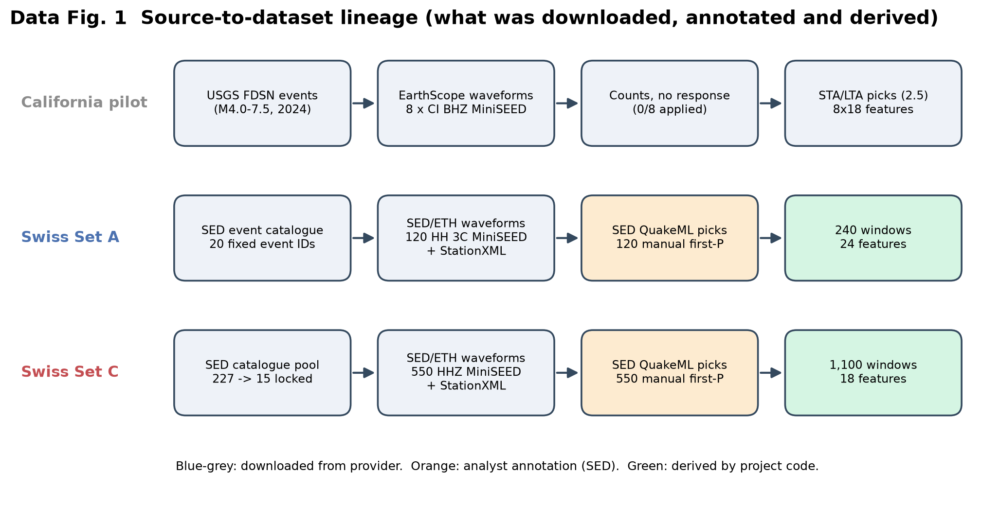

*Data Fig. 1. Blue-grey boxes are downloads, orange boxes are SED analyst annotations, green boxes are derived by project code. Source: manifests and scripts listed in section 6.*

The three stages are separate research stages with different sources and purposes. Their results are not combined into one performance number.

## 2. Data-source institutions

| Source | Data supplied | Purpose | Acquisition method | Reference |
|---|---|---|---|---|
| USGS FDSN event service | California event origin, location, magnitude | Event list for the pilot | `Client("https://earthquake.usgs.gov").get_events` in `scripts/download/download_iris_california_pilot.py` | https://earthquake.usgs.gov/fdsnws/event/1/ |
| EarthScope (formerly IRIS) FDSN dataselect | California BHZ MiniSEED | Pilot waveforms | `Client("EARTHSCOPE").get_waveforms` (`https://service.earthscope.org`) | https://www.earthscope.org/ |
| Swiss Seismological Service (SED, ETH Zurich) via EIDA | Swiss event catalogue, MiniSEED, StationXML, QuakeML arrivals (picks) | Set A and Set C | FDSN endpoints under `https://eida.ethz.ch/fdsnws/{event,station,dataselect,availability}/1/` (`configs/sed_switzerland_pilot.yaml`) | https://www.seismo.ethz.ch/ , https://eida.ethz.ch/ |

IRIS supplied waveforms only. In the California pilot, event information came from USGS and P-wave arrival information was produced by the project's own STA/LTA trigger. No analyst picks and no StationXML were obtained for California. For Switzerland, SED supplied events, waveforms, response metadata and the manual picks. Provider licence and citation terms were not reviewed for this report ("Not available in the current repository evidence"); see section 20.

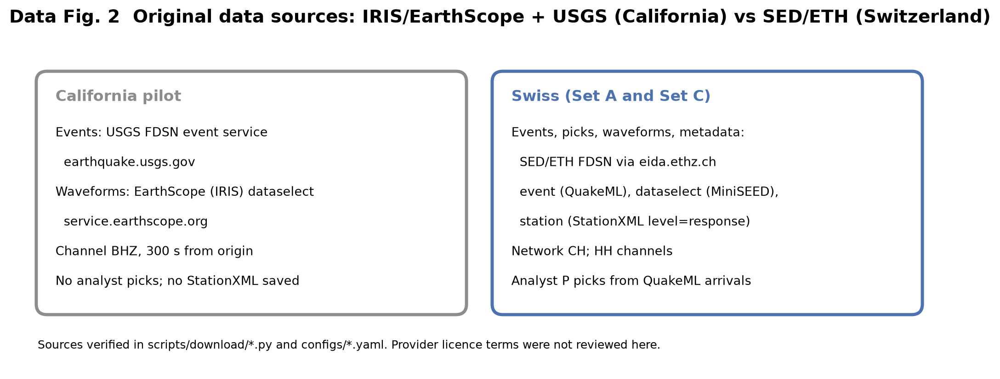

*Data Fig. 2. Source comparison. Source: scripts/download/ and configs/.*

## 3. California pilot acquisition (IRIS/EarthScope + USGS)

Script: `scripts/download/download_iris_california_pilot.py` (CLI: `--event-count`, `--min-events`, `--raw-dir`, `--manifest-csv`). Run record: `logs/iris_california_pilot_summary.json` (generated 2026-07-29; `logs/` is git-ignored).

1. **Event query** (USGS): 2024-01-01 to 2024-12-31, California box 32.5 to 42.0 N, -124.5 to -114.0 E, magnitude 4.0 to 7.5, ordered by time. 41 catalogue matches.
2. **Event selection:** scan the catalogue in order until 8 events yield a non-empty waveform file (minimum 5 required). Event choice is therefore "first 8 events that returned data", not a designed sample.
3. **Station choice:** a fixed list of predefined California broadband sites, ranked by epicentral distance to the event; up to 5 attempts per event; 1 station kept per event. Result: CI.ADO and CI.USC (manifest). The run summary's `stations` list also contains attempted stations that returned no data and must not be read as stations with data.
4. **Waveform request:** channel BHZ, 300 s starting at the origin time (`starttime=ot`, `endtime=ot+300`). No pre-event segment, so noise reference windows inside these records are short.
5. **Storage:** `data/raw/iris/quakeml_earthquake.usgs.gov_fdsnws_event_1_query_eventid_<id>_format_quakeml/CI.<STA>.--.BHZ.<origin>.mseed`; manifest `data/manifests/iris_california_pilot_events.csv` (8 rows; magnitude 4.05 to 4.87; origins 2024-05-01 to 2024-10-25; 40 Hz).
6. **Validation:** per-event non-empty file check inside the script. See `docs/IRIS_DATASET_REPORT.md`.

**Local copy.** `data/raw/iris/` holds 12 MiniSEED files, 76 event folders (most empty). Four files are **not** listed in the manifest (`CI.ADO.--.BHZ.20240823T153158`, `CI.ADO.--.BHZ.20241114T024035`, `CI.ADO.--.BHZ.20241209T230831`, `CI.USC.--.BHZ.20240912T142821`). The repository gives no explanation for them; the manifest's 8 files define the pilot.

**California processing (frozen, v1.0.0).** `scripts/analysis/run_california_{pilot_eda,signal_analysis,preprocessing,feature_engineering}.py`. P-wave onset was picked by ObsPy `classic_sta_lta` (STA 0.5 s, LTA 10 s) with `trigger_onset` threshold 2.5 and off-threshold 0.5. Preprocessing: demean, linear detrend, 5% Hann taper, 0.1 to 15 Hz bandpass (4 corners, zero-phase), peak normalisation. **Response removal was not applied (0 of 8)** because the StationXML fetch raised an error; amplitudes remain in digital counts (`docs/PREPROCESSING_REPORT.md`). Output: `reports/features/feature_matrix.csv` (8 x 25 columns, 18 features in three groups: 9 time-domain, 5 frequency-domain, 4 earthquake-specific). It is documented in `docs/FEATURE_ENGINEERING_REPORT.md` and is not used by the ML-3/ML-4 models.

## 4. Swiss acquisition (SED via EIDA)

### 4.1 Set A (Swiss SED methods-transfer acquisition, 2026-09-06; `configs/sed_switzerland_pilot.yaml`)

- **Events.** 20 fixed short IDs listed in the YAML (e.g. `2020btnrcj`, `2022rvutkg`, `2026idhhja`). They "were taken from the prior feasibility audit" and re-resolved against the live SED catalogue (2020-01-01 to 2026-09-07, M >= 2.5, box 45.4 to 48.3 N, 5.6 to 11.1 E) (`docs/SED_SWITZERLAND_DATASET_REPORT.md` section 3). The reason these 20 were originally chosen is **not available in the current repository evidence**.
- **Stations.** Network CH. For each event: FDSN availability query for HHZ/HHN/HHE/BHZ/BHN/BHE; prefer complete HH three-component stations; choose up to 6 stations from distance bins (0 to 50, 50 to 100, 100 to 150, 150 to 250, 250 to 400 km; at most 2 per bin) rather than the nearest stations. Result: exactly 6 per event, 120 records, 54 unique stations. Availability queries timed out for some station batches, so the 54 are not a complete CH snapshot (`SED_SWITZERLAND_DATASET_REPORT.md` limitations).
- **Waveforms.** `dataselect` request origin -90 s to +210 s, location blank, channel wildcard `HH?`. Written as one MiniSEED file per station containing the three components.
- **Response metadata.** StationXML at `level=response`, same window, saved as `CH.<STA>.--.HH.xml`.
- **Validation at download.** Each MiniSEED is read and checked for at least 60 s before and after origin (`min_pre_event_seconds`, `min_post_event_seconds`); 120/120 PASS, 120/120 StationXML YES, minimum pre-event 89.997 s and post-event 209.997 s (manifest columns `validation_status`, `pre_event_seconds`, `post_event_seconds`).
- **Response test.** `reports/switzerland_pilot/response_test.json`: remove_response to VEL tested on 3 events, PASS.
- **Mixed sampling rates:** 200 Hz (108 records) and 120 Hz (12 records).

### 4.2 Manual P picks for Set A (STEP ML-1A)

`scripts/download/download_sed_switzerland_set_a_picks.py` (no CLI arguments).

1. For each of the 20 events, request `https://eida.ethz.ch/fdsnws/event/1/query?eventid=<id>&format=xml&includearrivals=true&nodata=404` (tries the full resource ID, then the short ID).
2. Save the raw QuakeML to `data/metadata/switzerland/<short_id>/quakeml.xml` (provenance; git-ignored).
3. Parse `pick` elements (phase hint, evaluation mode and status, time, waveform ID, author).
4. Keep network CH picks whose phase is one of P, Pg, Pn, Pb, P1, Pdiff; match to each of the 120 records by station.
5. Prefer manual picks; if several, take the earliest and note the spread (ambiguity note in the manifest).
6. Verify the pick lies inside the waveform interval; exit with an error if any station has no pick.

Result: `data/manifests/sed_switzerland_set_a_picks.csv`, 120 rows, all `manual`; Pg 114, P1 3, Pn 3; pick time after origin 1.83 to 27.27 s. A pick is the analyst's estimate of the arrival time of the first P-type wave at that station. It is a reference annotation, not ground truth.

### 4.3 Set C (STEP 2I, 2I.1, 2J)

- **Pool.** SED text catalogue 2020-01-01 to 2026-09-11, M >= 2.5, same box: 251 rows; 24 excluded (20 in Set A, 1 atmospheric, 3 landslide); 227 independent earthquakes (`data/manifests/sed_switzerland_validation_candidates.csv`; `pool_role`: 212 pool, 15 proposed validation).
- **Selection.** The pool was built by `scripts/audit/audit_swiss_validation_candidates.py` with `configs/sed_switzerland_validation_audit.yaml`. The 15 events were locked as a "diversity sample" and "selected without using STA/LTA validation performance" (`docs/SWISS_INDEPENDENT_VALIDATION_PLAN.md`; the config says "Do not rank events by STA/LTA quality"). Configured diversity rules: year-bin quotas 4/4/4/3 over 2020 to 2021, 2022 to 2023, 2024, 2025 to 2026; minimum epicentral separation 15 km; at least 6 events in Swiss territory; magnitude bins 2.5 to 3.0, 3.0 to 3.5, 3.5 to 4.0, 4.0 and above; latitude/longitude split at 46.85 N / 8.35 E. The final 15 IDs are listed in the config (`locked_proposed_event_ids`); the step-by-step ranking that produced exactly these IDs is not documented beyond the config and the candidate table. 9 of 15 events are `immediate_border` (Austria, France, Germany, Liechtenstein), so the set is named *Independent Swiss/Adjacent-Border Validation Set*.
- **Stations.** Rule `all_audit_same_station_first_p_and_hhz`: download HHZ for every audit-supported station that has both a same-station SED first-P pick and an HHZ record. No distance-bin ranking and no per-event cap (events have 3 to 62 records). HHZ only; HHN/HHE were not acquired.
- **Window.** `dataselect` origin -60 s to +90 s.
- **Metadata.** StationXML per record (`CH.<STA>.--.HHZ.xml`), status verified for 550/550.
- **Picks.** Retrieved with the full SED resource ID (`smi:ch.ethz.sed/...`) because the short ID returned no QuakeML; `data/manifests/sed_switzerland_validation_picks.csv`, 550 rows, all `manual`; Pg 390, P1 87, Pn 73.
- **Validation.** Manifest `sed_switzerland_validation_waveforms.csv` (38 columns): download ok 550/550, verification PASS 550/550, coverage full 550/550, gaps 0, overlaps 0.
- **Sampling rates:** 200 Hz (514), 120 Hz (30), 100 Hz (6).
- **Frozen detector.** STEP 2K ran a record-level STA/LTA detector (threshold 8.0) on these records (`scripts/analysis/run_swiss_independent_validation.py`); see section 18.

## 5. What the raw files are

- **MiniSEED** (`.mseed`): the standard seismology archive format for continuous waveform samples. A file holds one or more *traces*; each trace has a network, station, location and channel code (e.g. `CH.EMBD..HHZ`), a start time, a sampling rate and integer or float samples in **digital counts**. Timing is implied by start time plus sample index over sampling rate. `HH` is a broadband high-rate seismometer channel; the last letter is the component: Z vertical, N north, E east.
- **StationXML**: station and channel metadata (coordinates, azimuth/dip, sampling) and the **instrument response** (sensor and digitiser transfer function). It is needed to convert counts into ground velocity in m/s with `remove_response`. California has none saved; Set A and Set C have it for every record.
- **QuakeML**: event catalogue format. Used here only for the SED event QuakeML saved as `data/metadata/<set>/<short_id>/quakeml.xml` (origins, magnitudes, picks and arrivals). `data/raw/catalogs/catalog.xml` is a separate USGS test catalogue from `configs/acquisition_config.yaml` (IU.ANMO test configuration), not part of the three datasets.
- **Manual phase picks**: per-station arrival-time annotations by SED analysts, delivered in the QuakeML. In the manifests they appear as `pick_phase`, `pick_time_utc`, `pick_evaluation_mode` (`manual`), `pick_source`. They link to records through `short_id` + `station` (+ `channel`).

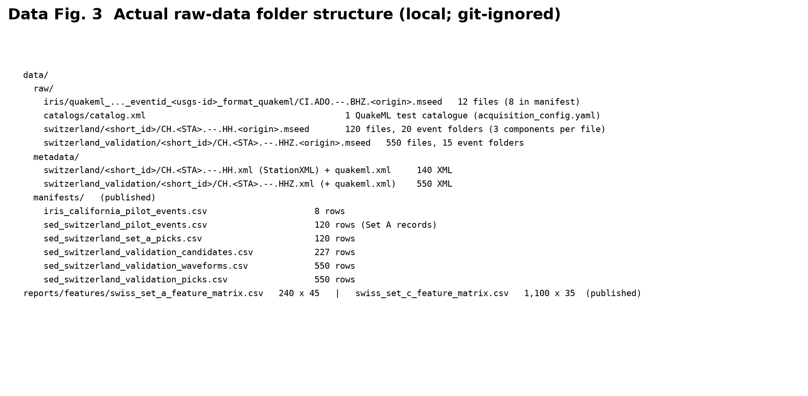

*Data Fig. 3. Actual local layout and counts. Source: filesystem audit, `reports/data_lineage/data_lineage_summary.json`.*

**Local versus published (A to E).**

| Class | Content |
|---|---|
| A. Raw data physically in the local repository | `data/raw/iris` (12 MiniSEED), `data/raw/switzerland` (120), `data/raw/switzerland_validation` (550), StationXML/QuakeML under `data/metadata/` (140 + 550 + QuakeML) |
| B. Local but excluded from GitHub | All of class A (`.gitignore`: `data/raw/`, `data/metadata/**/*.xml`) |
| C. Published on GitHub | Manifests (`data/manifests/*.csv`), feature matrices, saved models, JSON/CSV results, scripts, figures, documents |
| D. External only | The provider archives (USGS, EarthScope, SED/ETH EIDA) |
| E. Reconstructable by script | Class A, via the three `scripts/download/` scripts (section 22 of this report and the reproduction guide) |

GitHub does **not** contain waveforms, so a reviewer cannot run feature extraction without re-downloading them. Exclusion reasons: size (about 41 MB of MiniSEED and about 32 MB of XML) and the provider terms, which were not reviewed.

## 6. Preprocessing journey

The Swiss feature scripts are `scripts/analysis/run_swiss_set_a_feature_engineering.py` (STEP ML-2) and `scripts/analysis/run_swiss_set_c_feature_engineering.py` (STEP ML-4).

| # | Stage | Script / function | Input | Operation and parameters | Output |
|---|---|---|---|---|---|
| 1 | Acquisition | `scripts/download/*.py` | FDSN services | See sections 3 and 4 | MiniSEED, StationXML, QuakeML, manifests |
| 2 | Record and metadata validation | download scripts; feature scripts | MiniSEED, XML | Set A: >= 60 s pre/post origin, complete HH 3C (`has_complete_hh_3c`); Set C: coverage, gaps, StationXML verified. Feature scripts skip a record and log a failure if MiniSEED, StationXML or a pick is missing | manifest status columns |
| 3 | Waveform reading | ObsPy `read`; Set C `merge(method=1, fill_value="interpolate")` if fragmented | `.mseed` | Trace(s) in counts | ObsPy Stream |
| 4 | Time/sampling checks | download validation; `slice_window*` | Stream | Windows must lie inside the trace, else the record fails | none |
| 5 | Response correction | ObsPy `remove_response` | Stream + StationXML | Demean, linear detrend, 5% Hann taper, `output="VEL"`, `water_level=60`, `zero_mean=True`, `taper=False`, with a cosine pre-filter (f1=0.05, f2=0.08 Hz; f3, f4 differ, see 6.1) | ground velocity, m/s |
| 6 | Filtering | `Stream.filter` | velocity | Bandpass 0.1 to 15 Hz, 4 corners, **zerophase=True**, on the full trace | filtered velocity |
| 7 | Component selection | `identify_hh_components` (A); single trace `st[0]` (C) | Stream | A: HHZ, HHN, HHE; C: HHZ | arrays |
| 8 | Event/station association | manifests | rows | Set A: manifest row + pick by (`short_id`, station); Set C: waveform manifest row carries its pick | metadata |
| 9 | P-pick alignment | feature scripts | pick time | Positive window starts at the analyst pick | window start |
| 10 | Window construction | `slice_window*` | filtered arrays | 4.0 s windows (section 6.2) | windows |
| 11 | Labels | feature scripts | window type | Positive `is_earthquake=1`, negative `0` | label column |
| 12 | STA/LTA trace | ObsPy `classic_sta_lta` | filtered Z | LTA 10 s; STA 0.5 s (A) or 1.0 s (C); computed on the full trace, then sliced to the window | `sta_lta_max/mean` inputs |
| 13 | Feature extraction | `extract_3c_window_features` (A), `extract_vertical_channel_features` (C) | windows | Section 7 | feature rows |
| 14 | Feature matrix | `main()` | rows | One row per window with metadata | `reports/features/swiss_set_{a,c}_feature_matrix.csv` |
| 15 | Dataset validation | `tests/test_swiss_set_a_features.py`, `tests/test_vertical_models.py`; lineage audit | matrices | Finite values, schema, counts | pass/fail, `data_lineage_summary.json` |

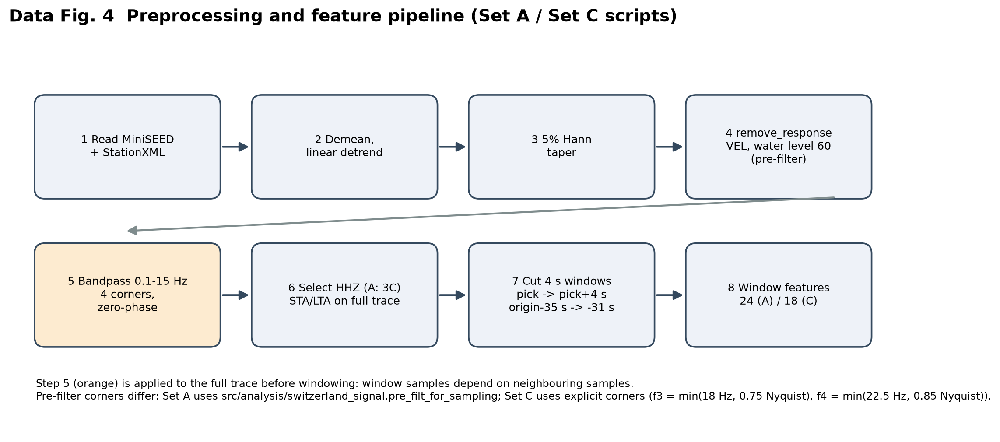

*Data Fig. 4. Source: the two feature scripts.*

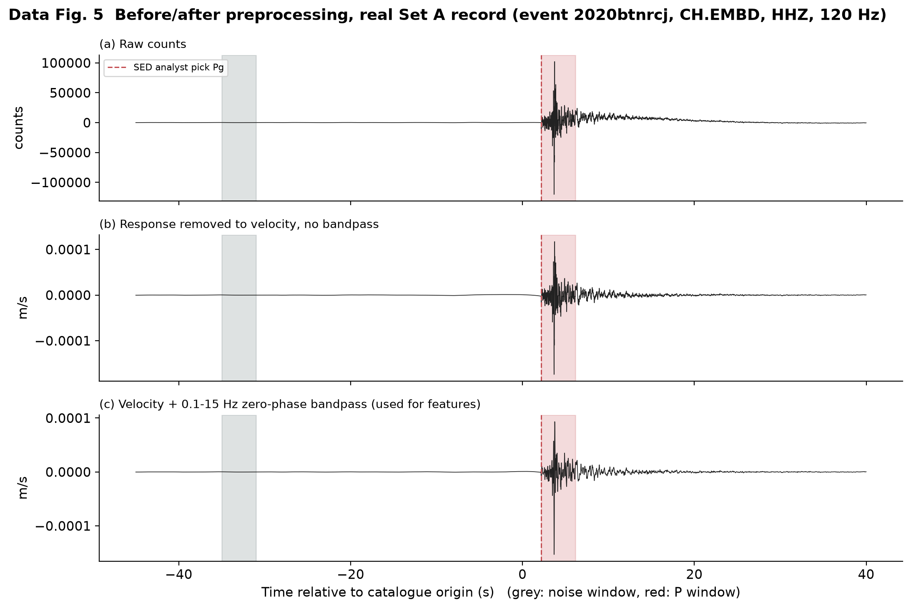

*Data Fig. 5. One real Set A record (event 2020btnrcj, CH.EMBD, HHZ, 120 Hz): (a) raw counts, (b) velocity after response removal, (c) velocity after the 0.1 to 15 Hz zero-phase bandpass. Grey: noise window (origin -35 s to -31 s). Red: P window (analyst pick to pick +4 s). Produced by applying the documented steps to this one record for display; no dataset was modified. Source: `data/raw/switzerland/2020btnrcj/`, `data/metadata/switzerland/2020btnrcj/`.*

### 6.1 Disclosures about the preprocessing

1. **"Causal windows" means window placement only.** The zero-phase bandpass (step 6) runs on the full trace before windows are cut, so each window sample depends on neighbouring samples, including later ones. The pipeline is not shown to be causal, and it must not be described as suitable for real-time operation. The practical effect of this choice has not been quantified. It is applied identically to both classes and both sets.
2. **STA window differs between sets.** `STA_WINDOW_S` is 0.5 s in the Set A script and 1.0 s in the Set C script. This changes `sta_lta_max` and `sta_lta_mean` between training and evaluation data. Numerical impact on Set C results: **unverified**.
3. **Pre-filter corners differ between sets (newly noted).** Set A computes the response pre-filter with `src/analysis/switzerland_signal.pre_filt_for_sampling` (f1 0.05, f2 0.08 Hz, f3 and f4 as 0.75 and 0.85 of Nyquist, e.g. 45/51 Hz at 120 Hz sampling and 75/85 Hz at 200 Hz). Set C uses explicit corners f3 = min(18 Hz, 0.75 Nyquist) and f4 = min(22.5 Hz, 0.85 Nyquist), so 18/22.5 Hz at 120 and 200 Hz sampling. Both are followed by the same 0.1 to 15 Hz bandpass, so the effect is probably small, but it is **unverified**. "Identical preprocessing" is therefore not an accurate description.
4. **Response correction differs by stage.** California was left in counts; both Swiss sets are in m/s.
5. No explicit check for earthquake or noise contamination of the noise window was found in the feature scripts.
6. If the continuous STA/LTA trace is unavailable for a window the code sets `sta_lta_max = sta_lta_mean = 1.0`. No such case is recorded (no failures in the feature summaries).

### 6.2 Window construction (both sets)

- **Positive (class 1, `early_p_wave`):** pick time to pick + 4.0 s.
- **Negative (class 0, `ambient_noise`):** origin - 35 s to origin - 31 s. Noise windows are pre-origin, so they are quiet only if no other seismic energy was present; this is assumed, not checked.
- One positive and one negative window per record: Set A 120 + 120 = 240; Set C 550 + 550 = 1,100.

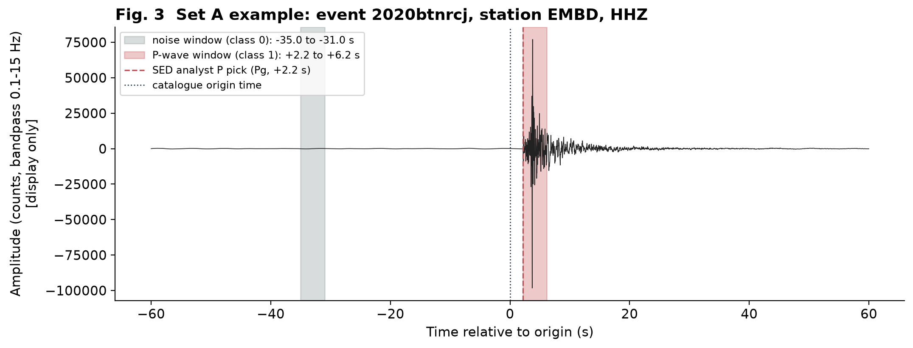

*Fig. 3 (research package). Positive and negative windows on a real trace. Source: Set A feature matrix rows and `data/raw/switzerland/`.*

**Windows are not independent events.** The 240 Set A windows come from 120 records of 20 earthquakes; the 1,100 Set C windows from 550 records of 15 earthquakes. Windows from one earthquake share source and path, which is why validation groups by event.

## 7. Feature engineering

A **feature** is a number computed from a waveform window. Classifiers need fixed-length numeric vectors; a 4 s window at 120 to 200 Hz has 480 to 800 samples, so each window is summarised by amplitude, energy, frequency-content and shape statistics. All definitions below come from `extract_single_channel_features`, `_spectral_features` and `extract_3c_window_features` (Set A script); the Set C script uses the same formulas on the vertical channel. The complete dictionary with units and availability is in [DATA_DICTIONARY.md](DATA_DICTIONARY.md).

- **Amplitude:** `z_peak_velocity_m_s` (max |v|), `z_p2p_amplitude_m_s`, `z_rms_velocity_m_s`, `z_cav_m_s`.
- **Energy:** `z_variance`, `z_std`, `z_signal_energy_m2_s` (sum v^2 times dt).
- **Shape / statistics:** `z_crest_factor` (peak/RMS), `z_kurtosis`, `z_skewness`, `z_zero_crossing_rate_hz`.
- **Frequency (FFT power spectrum, positive frequencies):** `z_dominant_frequency_hz`, `z_spectral_centroid_hz`, `z_spectral_bandwidth_hz`, `z_spectral_rolloff_95_hz`, `z_spectral_entropy` (Shannon entropy in bits of the normalised power spectrum).
- **STA/LTA:** `sta_lta_max`, `sta_lta_mean` (max and mean of the ObsPy `classic_sta_lta` characteristic function inside the window).
- **Three-component only (Set A, 24-feature models):** `h_peak_velocity_m_s`, `h_rms_velocity_m_s` (horizontal vector sqrt(N^2+E^2)), `vec3c_peak_velocity_m_s`, `vec3c_rms_velocity_m_s`, `vh_ratio` (Z RMS / horizontal RMS), `snr_db` (20 log10 of 3C RMS over the RMS of the vertical trace in origin -45 s to -15 s of the same record, floor 1e-6 linear).

Notes on definitions as implemented: `z_cav_m_s` is `sum(|v|) * dt` of velocity, which has dimension of length (metres) although the column name carries `m_s`; the name is kept as in the saved schema. `snr_db` uses a quiet-window baseline from the same record that also contains the negative window.

**Schemas.** 24 features (Set A, STEP ML-3 models) = 16 `z_*` + `h_peak`, `h_rms`, `vec3c_peak`, `vec3c_rms`, `vh_ratio` + `sta_lta_max`, `sta_lta_mean` + `snr_db`. 18 features (STEP ML-4 vertical) = the 16 `z_*` + `sta_lta_max`, `sta_lta_mean`. Verified (`data_lineage_summary.json`): the vertical schema JSON, `VERTICAL_FEATURE_COLUMNS`, both saved vertical models and the Set C inference call have the same 18 names in the same order; the 24-feature models' column order equals the Set A matrix order; no NaN values in either feature set.

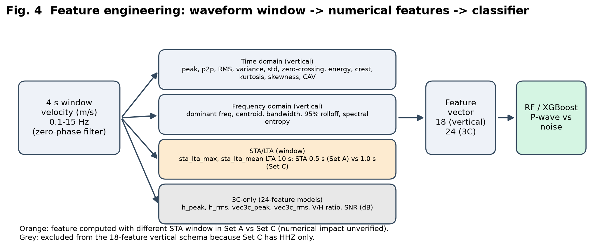
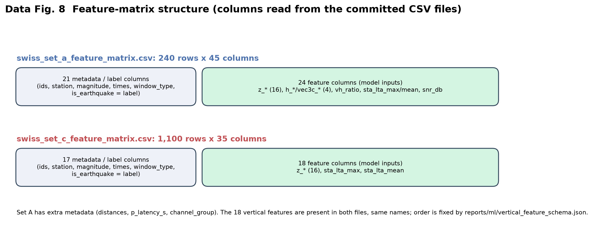

*Fig. 4 (package) and Data Fig. 8. Source: feature scripts and matrix headers.*

## 8. Swiss Set A in detail

**Why:** to transfer the California workflow to European data, acquire independent analyst labels, and train supervised models. **Events:** 20 (magnitudes 2.97 to 4.74, `MLh`/`MLhc`; regions include Graechen, Elm, Arolla, Porrentruy, Mulhouse F, Annecy F). **Records:** 120 = 20 events x 6 stations, each a three-component HH file. **Stations:** 54. **Distances:** epicentral 6.1 to 161.8 km (feature matrix). **Labels:** 120 manual SED first-P picks (Pg 114, P1 3, Pn 3). **Windows:** 240 (120 positive, 120 negative). **Features:** 24. **Training use:** Random Forest and XGBoost, 20-fold Leave-One-Group-Out CV grouped by earthquake event, then the 18-feature vertical variants. The 20 events are listed in `data_lineage_summary.json` (`set_a.events_table`).

## 9. Swiss Set C in detail

**Why:** an evaluation set whose events were not used for development. **Events:** 15 (magnitudes 2.59 to 4.11; 6 interior, 9 border). **Records:** 550 HHZ-only files; records per event from 3 to 62. **HHZ only** because the acquisition rule downloaded only the vertical channel (`channel: HHZ`); horizontal channels were not requested, so the 6 three-component-dependent features cannot be computed. **Stations:** 79. **Labels:** 550 manual first-P picks. **Windows:** 1,100 (550 + 550). **Features:** 18 vertical. **Use:** evaluation of the frozen Set A-trained vertical Random Forest and XGBoost, plus a window-level STA/LTA baseline.

**Independence clarification.**

- Event level: Set A and Set C share **0** events. This is the claimed independence.
- Station level: all **54** Set A stations also occur in Set C (54 of 79 Set C stations; 25 are Set C only; 417 of 550 Set C records are from shared stations). Set C therefore does **not** have entirely unseen stations.

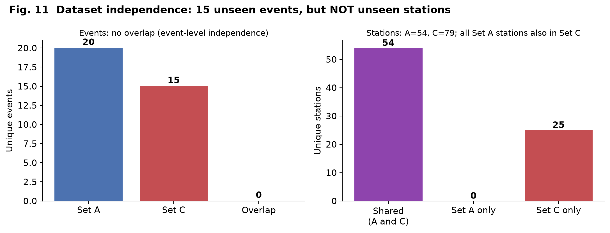
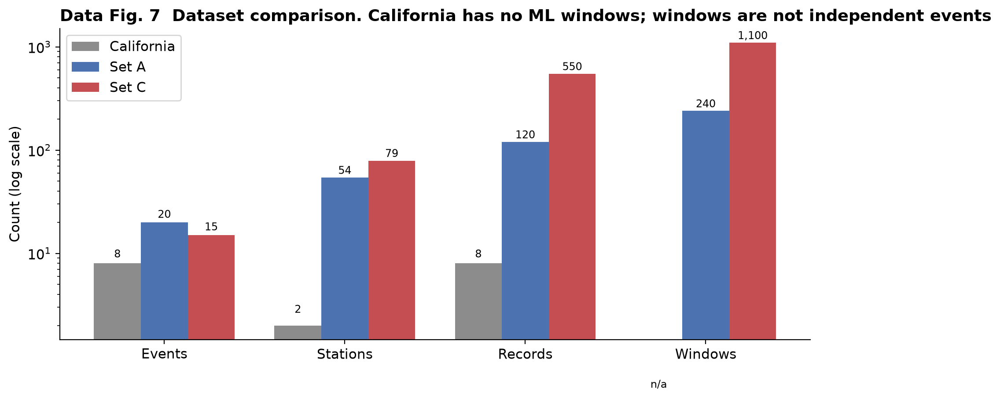
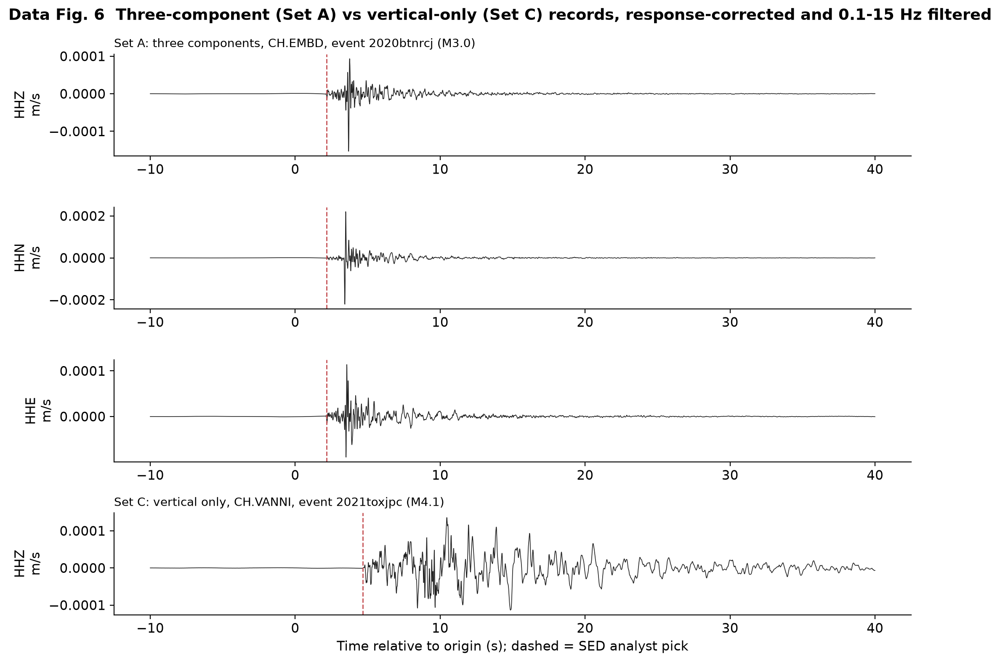

*Fig. 11 (package), Data Fig. 7 and Data Fig. 6. Source: feature matrices, manifests and real records (Set A EMBD, event 2020btnrcj; Set C VANNI, event 2021toxjpc).*

## 10. Data validation and quality control

Checks that exist in the repository (all numbers from `data_lineage_summary.json`):

| Check | Set A | Set C |
|---|---|---|
| Downloads OK | 120/120 | 550/550 |
| MiniSEED validation PASS | 120/120 | 550/550 |
| StationXML | 120/120 YES | 550/550 verified |
| Time coverage | >= 89.997 s pre, >= 209.997 s post origin | full coverage 550/550 |
| Gaps / overlaps | not recorded in the manifest | 0 / 0 |
| Manual first-P picks | 120 | 550 |
| Feature NaN | 0 | 0 |

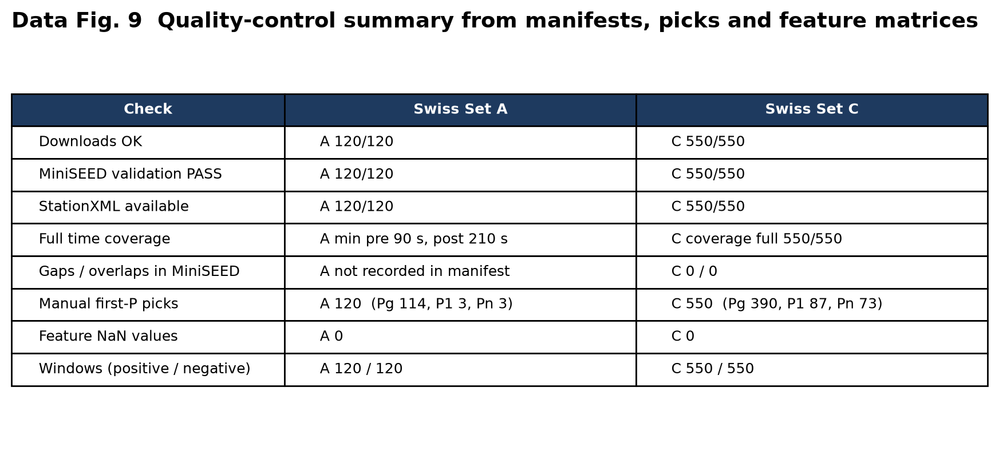

*Data Fig. 9. Source: manifests and matrices.* Unit tests: `tests/test_swiss_set_a_features.py`, `tests/test_switzerland_set_a_picks.py`, `tests/test_vertical_models.py`, `tests/test_switzerland_validation_acquisition.py`.

## 11. How the data were analysed

1. **Validation** (section 10).
2. **Candidate windows** (6.2).
3. **Features** (section 7).
4. **Training and cross-validation.** Random Forest (200 trees, depth 6) and XGBoost (100 trees, depth 4, learning rate 0.05), seed 42. Leave-One-Group-Out CV grouped by `short_id`: in each of 20 folds all windows of one earthquake are held out, so no earthquake appears in both training and test data. Grouping matters because windows from one event are correlated, and ungrouped splits would overstate accuracy.
5. **Independent evaluation.** Models were fitted on Set A, frozen, and applied to Set C once; decision threshold 0.5; no Set C tuning.
6. **Baseline.** The ML-4 baseline is **window-level**: `sta_lta_max >= 8.0` on each 4 s Set C window (STA 1.0 s). It is **not** the STEP 2K **record-level detector** (STA 0.5 s, LTA 10 s, first trigger in origin to origin +90 s, scored on 550 records: 401 detected = 72.9%, median absolute timing error 1.24 s; `reports/switzerland_validation/validation_summary.json`). The two use different units and settings and are not interchangeable.
7. **Interpretation.** Positive = P-wave window. *Precision* = fraction of flagged windows that are P-wave. *Recall* = fraction of P-wave windows found. *F1* = harmonic mean of the two. *ROC-AUC* = ranking quality over all thresholds. *False positive (FP)* = a noise window flagged as P-wave. *False negative (FN)* = a P-wave window missed. Verified Set C results (saved JSON): XGBoost F1 0.9169, FP 4, FN 81; Random Forest F1 0.9125, FP 3, FN 86; window-level baseline F1 0.5014, FP 0, FN 366. These show discrimination of pre-cut windows, not detection latency, continuous picking or operational alerting.

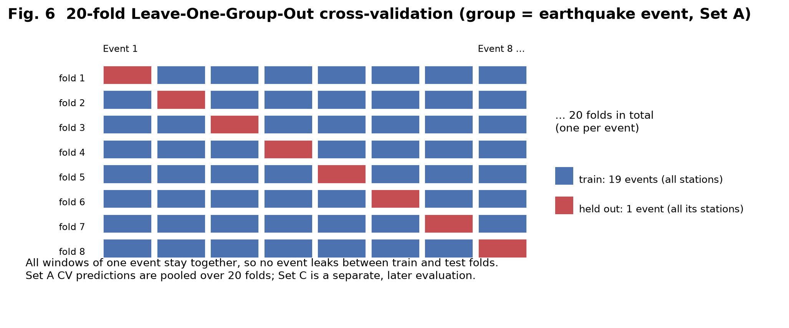

## 12. Dataset comparison

| Property | California | Set A | Set C |
|---|---|---|---|
| Provider | USGS + EarthScope | SED/ETH | SED/ETH |
| Events / records / stations | 8 / 8 / 2 | 20 / 120 / 54 | 15 / 550 / 79 |
| Channels | BHZ | HHZ+HHN+HHE | HHZ |
| Sampling | 40 Hz | 200 Hz (108), 120 Hz (12) | 200 (514), 120 (30), 100 (6) |
| Acquisition window | origin to +300 s | origin -90 to +210 s | origin -60 to +90 s |
| Magnitude | 4.05 to 4.87 | 2.97 to 4.74 | 2.59 to 4.11 |
| Station rule | distance-ranked predefined list, 1 per event | distance bins, <= 6 per event | all same-station pick and HHZ pairs |
| Response corrected | no | yes (m/s) | yes (m/s) |
| P labels | STA/LTA trigger (2.5) | 120 manual SED | 550 manual SED |
| ML windows | none | 240 | 1,100 |
| Features | 18 (counts) | 24 | 18 |
| Status | frozen v1.0.0 | development | independent evaluation |

California and Swiss results are never merged.

## 13. Provenance and integrity

- **Traceable chain:** provider endpoint -> download script -> raw file + manifest row -> feature script -> feature-matrix row (`sample_id` = `<short_id>_<station>_<noise|p_arrival>`) -> model input -> saved JSON results.
- **Picks:** raw QuakeML copies exist locally (`data/metadata/**/quakeml.xml`), not on GitHub.
- **Frozen items:** California v1.0.0, Set C membership (15 IDs), STEP 2K threshold 8.0, the four saved models.
- **Threshold 8.0** came from the Swiss Set A threshold grid with a pre-written rule (`configs/swiss_sta_lta_transfer.yaml`; `docs/SWISS_STA_LTA_TRANSFER_ANALYSIS.md`); the California baseline threshold was 2.5. The plan and results documents state 8.0 was pre-declared before Set C; Git history cannot independently prove the order (plan, configs and results arrive in one commit).
- **Integrity audit:** [../FINAL_INTEGRITY_CHECK.md](../FINAL_INTEGRITY_CHECK.md).

## 14. Limitations

Offline window classification only; small development set (240 windows, 20 events); event-level but not station-level independence; STA window (0.5 s vs 1.0 s) and pre-filter corner differences; zero-phase filtering before windowing; unverified noise-window cleanliness; vertical-only Set C (no particle-motion features); mixed sampling rates and different acquisition windows; magnitudes are SED local-magnitude types (`MLh`, `MLhc`), not comparable with the California `ml`/`mw` values; Set A stations are not a complete network snapshot; border-heavy Set C; California without response correction or analyst picks; the reason the original 20 Set A events were chosen and the exact ranking steps for the final 15 Set C IDs are not documented beyond the configs. Version labels: v1.0.0 is the frozen submission release; v1.8.0 is an internal documentation milestone.

## 15. Reproducibility and references

Commands, order and expected outputs: [DATA_ACQUISITION_AND_REPRODUCTION.md](DATA_ACQUISITION_AND_REPRODUCTION.md). ML steps: [ML_REPRODUCTION_GUIDE.md](ML_REPRODUCTION_GUIDE.md).

References (service documentation): USGS FDSN event service https://earthquake.usgs.gov/fdsnws/event/1/ ; EarthScope data services https://www.earthscope.org/data/ ; ETH/SED EIDA node https://eida.ethz.ch/ ; Swiss Seismological Service https://www.seismo.ethz.ch/ ; FDSN web service specifications https://www.fdsn.org/webservices/ ; MiniSEED and StationXML formats https://docs.fdsn.org/projects/source-identifiers/ and https://docs.fdsn.org/projects/stationxml/ ; ObsPy https://docs.obspy.org/ . Licence and citation terms of each provider must be checked before redistributing data.

## 16. Figure index

| Figure | File | Source of the plotted content |
|---|---|---|
| Data Fig. 1 lineage | `reports/figures/data/dfig01_source_to_dataset_lineage.png` | documented structure |
| Data Fig. 2 sources | `dfig02_iris_vs_sed_sources.png` | scripts and configs |
| Data Fig. 3 raw structure | `dfig03_raw_data_structure.png` | filesystem and manifests |
| Data Fig. 4 pipeline | `dfig04_preprocessing_pipeline.png` | feature scripts |
| Data Fig. 5 before/after | `dfig05_filtering_before_after.png` | real Set A record |
| Data Fig. 6 3C vs vertical | `dfig06_three_component_vs_vertical.png` | real Set A and Set C records |
| Data Fig. 7 comparison | `dfig07_set_a_vs_set_c_comparison.png` | `data_lineage_summary.json` |
| Data Fig. 8 matrix structure | `dfig08_feature_matrix_structure.png` | matrix headers |
| Data Fig. 9 QC | `dfig09_quality_control_summary.png` | manifests, matrices |
| Reused | `reports/figures/final/fig02, fig03, fig04, fig06, fig11` | see [RESEARCH_PACKAGE.md](RESEARCH_PACKAGE.md) |

Generation: `python scripts/reporting/audit_data_lineage.py` then `python scripts/reporting/make_data_figures.py`.
