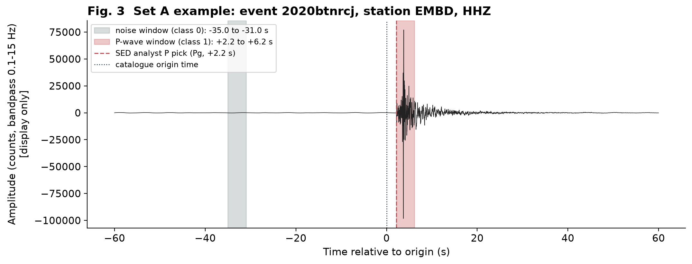
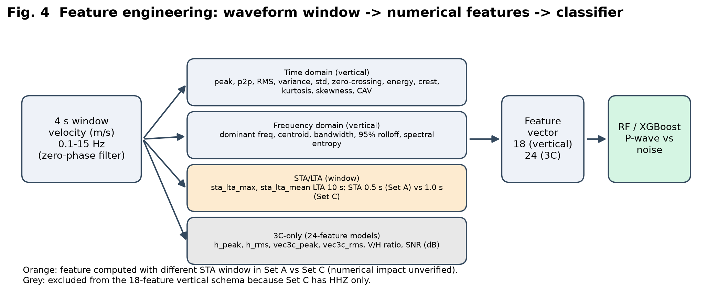
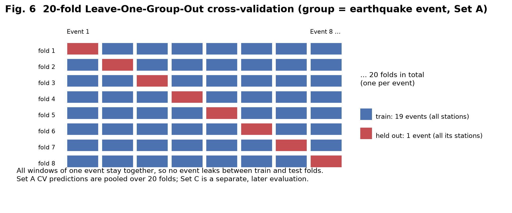
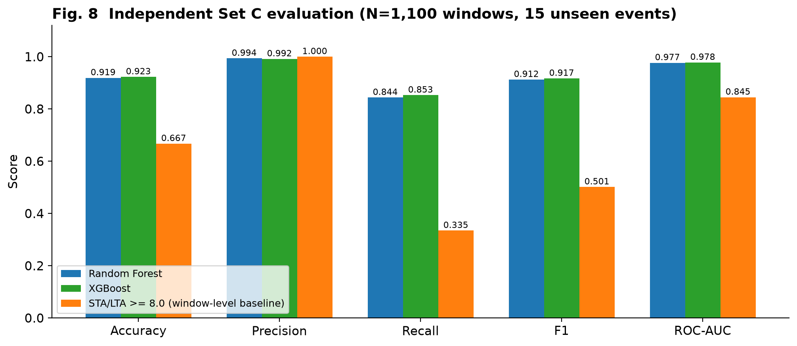
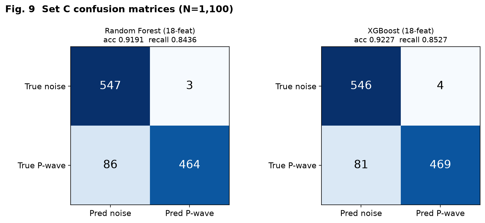
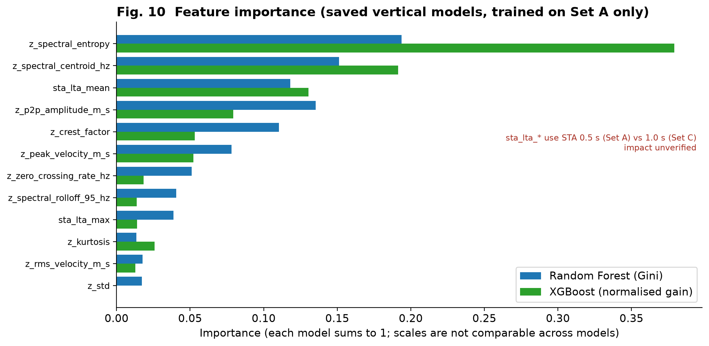
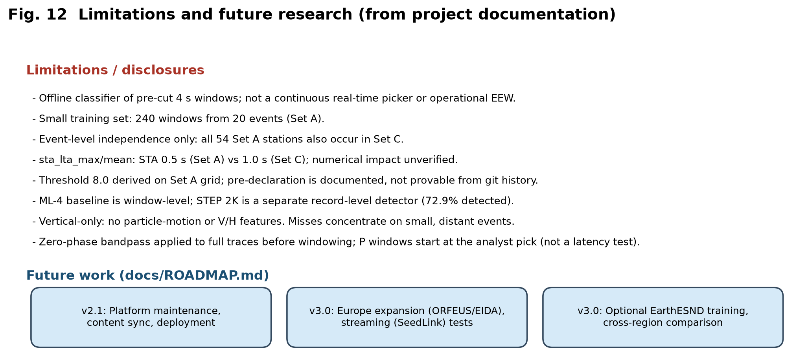

# AMGCR Research Package for Academic Review

Consolidated entry point for the supervisor review. It summarises existing authoritative documents and links to them; it adds no new results. Numbers come from the saved files in `reports/ml/`.

**Scope statement.** The work is an **offline window-classification benchmark**. It is not an operational real-time earthquake early warning (EEW) system.

**Versions.** v1.0.0 is the frozen submission release (29 July 2026, California pilot). v1.8.0 is an internal documentation milestone (STEP ML-4, 12 Nov 2026), not a software release.

## 1. Objective

Develop a reproducible, AI-assisted EEW research workflow for Western regions. Europe (Switzerland) is the long-term focus; the California IRIS pilot was the methods laboratory. Question tested here: can a supervised classifier trained on 20 Swiss events with analyst P picks recognise P-wave windows in 15 events it never saw, and how does it compare with an STA/LTA threshold rule? ([PROJECT_CHARTER.md](PROJECT_CHARTER.md))

## 2. Datasets

| Dataset | Role | Events | Stations | Records | Channels | Windows |
|---|---|---|---|---|---|---|
| California pilot (IRIS) | Frozen v1.0.0 baseline | 8 | see [IRIS_DATASET_REPORT.md](IRIS_DATASET_REPORT.md) | 8 | BHZ | 8 x 18 feature matrix |
| Swiss Set A | Development, training, cross-validation | 20 | 54 | 120 | CH HH (3C) | 240 (120 P + 120 noise) |
| Swiss Set C | Independent evaluation | 15 | 79 | 550 | CH HHZ | 1,100 (550 P + 550 noise) |

Provenance: Swiss waveforms and StationXML were downloaded from the SED/ETH FDSN service (`eida.ethz.ch`); see [SED_SWITZERLAND_DATASET_REPORT.md](SED_SWITZERLAND_DATASET_REPORT.md) and [SWISS_INDEPENDENT_VALIDATION_PLAN.md](SWISS_INDEPENDENT_VALIDATION_PLAN.md). Manifests are in `data/manifests/`. Raw MiniSEED is git-ignored (`data/raw/`).

**Independence (verified from `reports/features/swiss_set_{a,c}_feature_matrix.csv`).** Set A and Set C share **0 events**. All **54** Set A stations also occur in Set C (54 of 79 Set C stations shared, 25 Set C only). Independence is **event-level**; unseen stations are not claimed.

## 3. Labels

- Set A: 120/120 SED manual first-P picks acquired from the SED QuakeML (STEP ML-1A; `data/manifests/sed_switzerland_set_a_picks.csv`, phases Pg 114, P1 3, Pn 3). Labels are independent of the STA/LTA detector.
- Set C: same-station SED/manual first-P picks (`data/manifests/sed_switzerland_validation_picks.csv`).
- Window rule (both sets, from `scripts/analysis/run_swiss_set_{a,c}_feature_engineering.py`): positive window = analyst pick to pick + 4 s; negative window = origin - 35 s to origin - 31 s. Fig. 3 shows a real example.

## 4. Preprocessing

Per record: demean, linear detrend, 5% Hann taper, `remove_response(output="VEL", water_level=60)` with a pre-filter, then a 4-corner 0.1 to 15 Hz bandpass with `zerophase=True`, applied to the full trace before windows are cut. Units: m/s.

## 5. Features

- 24-feature 3C schema (STEP ML-3, Set A only): 16 vertical `z_*` features, `sta_lta_max`, `sta_lta_mean`, `h_peak_velocity_m_s`, `h_rms_velocity_m_s`, `vec3c_peak_velocity_m_s`, `vec3c_rms_velocity_m_s`, `vh_ratio`, `snr_db`.
- 18-feature vertical schema (STEP ML-4): the 16 `z_*` features plus `sta_lta_max`, `sta_lta_mean`. Exact names and order: `reports/ml/vertical_feature_schema.json` (identical in `src/models/vertical_models.py` and both saved models).
- `sta_lta_*` use `classic_sta_lta` with LTA 10 s. **STA = 0.5 s in Set A and 1.0 s in Set C** (scripts above). The numerical effect on Set C results is **unverified**.

## 6. Models and validation

- Random Forest: 200 trees, max depth 6, min split 4, min leaf 2, `max_features=sqrt`, `class_weight=balanced`, seed 42.
- XGBoost: 100 trees, max depth 4, learning rate 0.05, subsample 0.8, colsample 0.8, L1 0.1, L2 1.0, seed 42.
- Hyper-parameters are read from the saved model artifacts. Decision threshold 0.5, not tuned.
- Validation on Set A: 20-fold Leave-One-Group-Out, one fold per earthquake event, so all stations of a held-out event are excluded from training together.
- Set C is used only for the final evaluation of the frozen models.

## 7. Results (saved JSON in `reports/ml/`)

**Set A, LOGO CV, N=240**

| Model | Accuracy | Recall | F1 | ROC-AUC |
|---|---|---|---|---|
| RF 24-feature (ML-3) | 0.9917 | 0.9833 | 0.9916 | 0.9990 |
| XGB 24-feature (ML-3) | 0.9833 | 0.9750 | 0.9832 | 0.9990 |
| STA/LTA 8.0 (ML-3 baseline) | 0.9417 | 0.8917 | 0.9386 | 0.9710 |
| RF 18-feature (ML-4) | 0.9792 | 0.9667 | 0.9789 | 0.9994 |
| XGB 18-feature (ML-4) | 0.9833 | 0.9750 | 0.9832 | 0.9984 |

**Set C, independent, N=1,100**

| Model | Accuracy | Precision | Recall | F1 | ROC-AUC | TP | FP | TN | FN |
|---|---|---|---|---|---|---|---|---|---|
| XGBoost 18-feature | 0.9227 | 0.9915 | 0.8527 | 0.9169 | 0.9780 | 469 | 4 | 546 | 81 |
| Random Forest 18-feature | 0.9191 | 0.9936 | 0.8436 | 0.9125 | 0.9767 | 464 | 3 | 547 | 86 |
| Window-level STA/LTA (`sta_lta_max >= 8.0`) | 0.6673 | 1.0000 | 0.3345 | 0.5014 | 0.8448 | 184 | 0 | 550 | 366 |

Missed P-wave windows fall by 77.9% for XGBoost ((366-81)/366) and 76.5% for Random Forest ((366-86)/366) relative to the window-level baseline.

**Per-event.** Recall is lowest for the smallest Set C events (magnitude about 2.6 to 2.7; e.g. `2020flmsvb` RF 0.46, XGB 0.48). See `reports/ml/vertical_set_c_per_event_results.csv`.

## 8. Feature importance (saved vertical models)

`z_spectral_entropy` ranks first in both models (RF Gini 0.1937, XGB normalised gain 0.3791), followed by `z_spectral_centroid_hz` (0.1511, 0.1913). Full tables: [SET_C_VERTICAL_ML_EVALUATION_REPORT.md](SET_C_VERTICAL_ML_EVALUATION_REPORT.md) section 6 and Fig. 10. Importances describe model use of features, not physical causation.

## 9. The two STA/LTA "8.0" results

| | STEP 2K detector | ML-4 baseline |
|---|---|---|
| Unit | Record (550 HHZ records) | 4 s window (1,100 windows) |
| STA / LTA | 0.5 s / 10 s | 1.0 s / 10 s |
| Rule | Trigger within origin to origin + 90 s | `sta_lta_max >= 8.0` |
| Result | 401/550 detected (72.9%), median abs. timing error 1.24 s | recall 0.3345, F1 0.5014 |

Threshold 8.0 was chosen from the Swiss Set A threshold grid with a pre-written rule (`configs/swiss_sta_lta_transfer.yaml`, [SWISS_STA_LTA_TRANSFER_ANALYSIS.md](SWISS_STA_LTA_TRANSFER_ANALYSIS.md)). The California baseline threshold was 2.5. The plan and results documents state 8.0 was pre-declared before Set C; the Git history cannot independently prove the order.

## 10. Limitations and integrity disclosures

1. Offline classification of pre-cut windows; no continuous picking, detection latency or alerting claim.
2. Small training set (240 windows, 20 events).
3. Event-level independence only; all Set A stations also occur in Set C.
4. STA window mismatch (0.5 s vs 1.0 s) in two features; effect unverified.
5. A zero-phase bandpass is applied to full traces before windowing, so window samples depend on neighbouring (including later) samples. Positive windows start at the analyst pick. Both sets are treated identically; the effect is not quantified. Earlier documents describe the windows as "causal"; that wording refers to window placement only.
6. Vertical-only features omit particle-motion information. Misses concentrate on small events.
7. The ML-4 baseline differs from the STEP 2K detector (section 9).
8. Test counts quoted in older documents (89/89) were not re-run for this package; see [ML_REPRODUCTION_GUIDE.md](ML_REPRODUCTION_GUIDE.md) for what was run.
9. Audit: [../FINAL_INTEGRITY_CHECK.md](../FINAL_INTEGRITY_CHECK.md).

## 11. Future work (from [ROADMAP.md](ROADMAP.md))

Version 2.1: platform maintenance. Version 3.0: Europe expansion (ORFEUS/EIDA), streaming tests, optional EarthESND training, cross-region comparison.

## 12. Where to find everything

- Reproduction: [ML_REPRODUCTION_GUIDE.md](ML_REPRODUCTION_GUIDE.md)
- Paths, sizes, redistribution notes: [DATA_AND_MODEL_INVENTORY.md](DATA_AND_MODEL_INVENTORY.md)
- Website page: `/ml-evaluation` (see `website/README.md`)
- Figures: `reports/figures/final/` (generated by `scripts/reporting/make_final_figures.py`)
