# INDIAN INSTITUTE OF TECHNOLOGY JODHPUR

  

## Abstract

Earthquake Early Warning (EEW) depends on recognising the first arriving P-wave before the stronger shaking associated with later seismic phases reaches a location. Conventional short-term average/long-term average (STA/LTA) trigger rules are widely used for signal detection, but fixed thresholds can miss weak or emergent arrivals in noisy records. This study investigates a narrower and experimentally testable problem: whether supervised machine-learning models can distinguish analyst-labelled P-wave candidate windows from ambient-noise windows in previously unseen earthquake events.

The work developed from an initial California waveform pilot into a Swiss-data machine-learning study using records and manual first-P arrival picks from the Swiss Seismological Service (SED), accessed through the European Integrated Data Archive (EIDA). The development dataset, Set A, contains 20 earthquakes, 120 three-component records from 54 stations, and 240 labelled four-second windows. A separate evaluation dataset, Set C, contains 15 different earthquakes, 550 vertical-component records from 79 stations, and 1,100 labelled windows. Positive windows begin at SED analyst first-P picks; negative windows are selected from an earlier origin-relative interval. Instrument responses were removed to ground velocity, and time-domain, frequency-domain, waveform-shape and STA/LTA features were extracted.

Random Forest and XGBoost models were trained on Set A using 20-fold Leave-One-Group-Out cross-validation grouped by earthquake. Because Set C contains only vertical-component data, a separate 18-feature vertical-only model schema was trained on Set A, frozen, and evaluated on Set C. On Set C, XGBoost achieved an F1-score of 0.9169, recall of 0.8527 and precision of 0.9915; Random Forest achieved an F1-score of 0.9125, recall of 0.8436 and precision of 0.9936. The window-level STA/LTA baseline achieved an F1-score of 0.5014 and recall of 0.3345. These results correspond to 81 missed positive windows for XGBoost and 86 for Random Forest, compared with 366 for the window-level baseline.

From these results, the tested tree-based models classify the prepared P-wave and noise windows better than the selected window-level STA/LTA rule on Set C. However, the evaluation is independent at event level only: all 54 Set A stations also occur in Set C. The study also uses pick-aligned windows, a zero-phase filter applied to full traces, a limited number of earthquakes, and slightly different preprocessing settings between datasets. It therefore demonstrates offline candidate-window classification, not continuous-stream P-wave detection, warning-time performance, or operational EEW capability.

**Keywords:** Earthquake Early Warning; P-wave; seismic waveform; Random Forest; XGBoost; STA/LTA; feature engineering; event-grouped cross-validation; SED; EIDA.

---

## 1. Introduction

Earthquake Early Warning systems aim to provide useful information before strong ground motion reaches a target location. The approach relies on the fact that faster P-waves generally arrive before the more damaging S-waves. Detecting and characterising the first P-wave energy is therefore an important part of an EEW workflow.

Traditional seismic triggering methods commonly use a short-term average divided by a long-term average. The resulting STA/LTA ratio is compared with a threshold to identify possible signal onset. Although this approach is computationally simple, a fixed threshold may not respond equally well to different event magnitudes, source-to-station distances, background noise conditions and station characteristics.

Machine-learning methods provide another way to study waveform patterns. Instead of relying on one trigger statistic, a classifier can use several properties of a signal window, including amplitude, spectral distribution, waveform shape and STA/LTA measurements. Such a classifier must nevertheless be evaluated carefully. In seismic data, multiple records from the same earthquake are related; randomly splitting individual windows can therefore make test results appear stronger than their true ability to generalise to a new earthquake.

In this work, I have studied whether supervised machine-learning models can classify P-wave candidate windows. It uses earthquake-event grouping during model validation and a separate set of earthquake events for independent evaluation. The focus is on reproducible data preparation, feature extraction, model comparison and transparent reporting of limitations.

### 1.1 Research question

Can supervised classifiers trained on four-second, analyst-labelled seismic windows distinguish P-wave windows from ambient-noise windows on earthquake events not used during model development, and how do they compare with a selected STA/LTA window-level rule?

### 1.2 Scope

The current experiment is an **offline, pre-cut window-classification benchmark**. Positive windows are aligned to analyst P picks before classification. The experiment does not demonstrate automatic discovery of P-wave arrival times in continuous waveform streams. It does not measure operational warning time, live false-alert rates, earthquake magnitude, source location or ground-motion prediction.

---

## 2. Research objectives

The objectives of the completed research are:

1. Establish a documented workflow for acquiring and validating seismic waveform data and associated event metadata.
2. Use analyst-provided first-P arrival picks to construct labelled positive and negative waveform windows.
3. Apply consistent, documented signal-processing steps and extract numerical features from seismic records.
4. Train and evaluate Random Forest and XGBoost classifiers using event-grouped validation.
5. Evaluate frozen vertical-only models on a separate set of earthquake events.
6. Compare the classifiers with the specified STA/LTA window-level baseline.
7. Report limitations, threats to validity and the additional work required before any continuous or operational EEW application.

---

## 3. Research development and datasets

### 3.1 Initial California pilot

The project first started with a California pilot using USGS event information and EarthScope waveform data. The frozen pilot contains eight earthquakes, eight BHZ waveform records, two stations (CI.ADO and CI.USC), a sampling rate of 40 Hz and 300-second records beginning at catalogue origin time.

The California work established the initial acquisition, exploratory analysis, signal-analysis, preprocessing and feature-engineering workflow. It produced an 8 × 18 feature matrix. Instrument response removal was not applied in the frozen California run (0 of 8 records), so amplitudes remained in digital counts. The California pilot did not provide the supervised training and independent evaluation results reported in this document.

The California pilot is retained as an early methods-development stage. Its measurements must not be combined with the Swiss model evaluation metrics.

### 3.2 Swiss Set A — model development

Swiss Set A was acquired using SED data through EIDA. It contains:

| Attribute | Set A |
|---|---:|
| Earthquake events | 20 |
| Three-component records | 120 |
| Stations | 54 |
| Manual SED first-P picks | 120 |
| Positive P-wave windows | 120 |
| Negative ambient-noise windows | 120 |
| Total labelled windows | 240 |
| Full feature schema | 24 features |
| Vertical-only feature schema | 18 features |

The records include three-component HH data. StationXML metadata was available for response correction. The SED QuakeML arrival information supplied manual first-P picks. The phase distribution recorded for Set A is Pg 114, P1 3 and Pn 3.

### 3.3 Swiss Set C — independent event evaluation

Set C was acquired as a separate evaluation dataset. It contains:

| Attribute | Set C |
|---|---:|
| Earthquake events | 15 |
| Vertical HHZ records | 550 |
| Stations | 79 |
| Manual SED first-P picks | 550 |
| Positive P-wave windows | 550 |
| Negative ambient-noise windows | 550 |
| Total labelled windows | 1,100 |
| Feature schema | 18 vertical features |

The phase distribution recorded for Set C is Pg 390, P1 87 and Pn 73. No earthquake event is shared between Set A and Set C. However, all 54 stations in Set A also occur in Set C; Set C includes 25 additional stations. The evaluation is therefore independent at event level, but not at station level.

### 3.4 Where the data came from and how it was collected

The project uses data from three public data services. The California pilot and the Swiss datasets are kept separate because they were collected at different stages and for different purposes.

| Organisation / service | Information used in this project | How it was used |
|---|---|---|
| U.S. Geological Survey (USGS), FDSN Event service | Event origin time, location and magnitude for California | To prepare the California event list |
| EarthScope (earlier IRIS DMC), FDSN dataselect | California BHZ waveform data in MiniSEED format | To download one vertical waveform record for each selected event |
| Swiss Seismological Service (SED), ETH Zurich, through EIDA | Swiss event catalogue, waveform data, station response information and QuakeML arrivals | To prepare Set A and Set C, including the manual P-arrival labels |

The California event search covered 1 January to 31 December 2024. The search box was 32.5°–42.0° N and 124.5°–114.0° W, with magnitude between 4.0 and 7.5. It returned 41 catalogue matches. The acquisition script checked events in time order and kept the first eight for which a waveform was returned. Therefore, these eight events should not be treated as a statistically selected sample of California earthquakes.

For Set A, the project used 20 event IDs from an earlier feasibility audit. The SED catalogue was queried again to resolve those events. The configured catalogue search covered 1 January 2020 to 7 September 2026, with magnitude at least 2.5 and a region between 45.4°–48.3° N and 5.6°–11.1° E. The reason why those original 20 events were selected is not recorded in the repository.

For Set C, a candidate pool of 251 catalogue rows was checked. After excluding the 20 Set A events and four non-earthquake entries (one atmospheric event and three landslides), 227 independent earthquake candidates remained. Fifteen events were selected using the documented diversity rules. These rules included year-wise quotas, magnitude groups, a minimum separation of 15 km, geographical divisions and a requirement that at least six events be in Swiss territory. The exact step-by-step ranking of the final 15 events is not recorded. Nine of the 15 events are described in the project records as immediate-border events, so Set C is more accurately called the Swiss/adjacent-border evaluation set.

### 3.5 What files were downloaded?

The raw waveform and metadata files have different roles. They are not the same as the CSV feature matrices used by the machine-learning models.

| File type | What it contains | Use in this project |
|---|---|---|
| MiniSEED (.mseed) | Sampled seismic waveform values with station, channel, start time and sampling-rate information | Main waveform input |
| StationXML (.xml) | Station coordinates, channel details and instrument response | Needed to convert recorded counts into ground velocity |
| QuakeML (.xml) | Event details and phase arrival information | Used to obtain SED first-P picks |
| CSV manifest | Event, station, file, pick and validation information in rows | Keeps a record of which data belongs to each dataset |
| Feature matrix (CSV) | One row per labelled window, with metadata, label and calculated features | Input to the ML experiments |

In the California pilot, 12 MiniSEED files are present in the local working copy, but only eight are listed in the frozen event manifest. The other four are not used in the reported pilot analysis because their origin is not established in the repository. For Swiss Set A there are 120 MiniSEED waveform files. The local metadata includes 120 StationXML files and QuakeML event information. Set C has 550 MiniSEED files and 550 verified StationXML files, with the corresponding QuakeML pick records.

The raw Swiss records have different sampling rates. In Set A, 108 records are sampled at 200 Hz and 12 at 120 Hz. In Set C, 514 records are sampled at 200 Hz, 30 at 120 Hz and 6 at 100 Hz. The feature extraction scripts use the sampling rate of each trace when processing it. The records are not all identical in length or sampling rate, which is one reason that the acquisition and validation steps are important.

The raw MiniSEED and XML files are available in the local research working copy but are not committed to GitHub. The repository publishes the manifests, derived feature matrices, models, result files, scripts and figures. Raw files were excluded because of their size and because the providers' redistribution terms have not yet been reviewed. A reviewer can inspect the published model inputs and results, but waveform-level reproduction requires downloading the source data again.

### 3.6 How the records were selected and labelled

Set A uses six stations for each of its 20 events, giving 120 three-component records. The acquisition configuration preferred complete HHZ, HHN and HHE channel groups. It selected stations from distance bands up to 400 km, with a maximum of two stations per distance band. The resulting dataset has 54 unique stations. Some availability queries timed out, so this is not a complete list of all stations that could have recorded those events.

Set C follows a different rule. It includes every audit-supported station for which both a same-station SED first-P pick and an HHZ waveform were available. There was no fixed number of stations per event. As a result, the number of records per event varies from 3 to 62. Set C has 79 stations in total.

The SED picks were retrieved from QuakeML and matched to waveform records by event and station. The pick records used for the experiment are marked as manual in the manifests. The phase counts are:

| SED phase label | Set A picks | Set C picks |
|---|---:|---:|
| Pg | 114 | 390 |
| P1 | 3 | 87 |
| Pn | 3 | 73 |
| **Total** | **120** | **550** |

These phase labels are retained as supplied by SED. For the binary classification task, all these first-P-type picks are used to mark the positive window. The label is not generated by the machine-learning model or by the STA/LTA baseline.

### 3.7 Dataset sizes at a glance

The following table shows why the number of windows should not be confused with the number of independent earthquakes.

| Dataset | Events | Records | Positive windows | Noise windows | Total windows |
|---|---:|---:|---:|---:|---:|
| California pilot | 8 | 8 | Not used in current ML experiment | Not used | Not part of ML-3/ML-4 |
| Swiss Set A | 20 | 120 | 120 | 120 | 240 |
| Swiss Set C | 15 | 550 | 550 | 550 | 1,100 |

Each Swiss record produces two windows. So, for example, 1,100 Set C windows do not mean that the research has 1,100 independent earthquake events. They come from 15 earthquakes and 79 stations. This difference is considered in the validation method by grouping the Set A folds by earthquake.

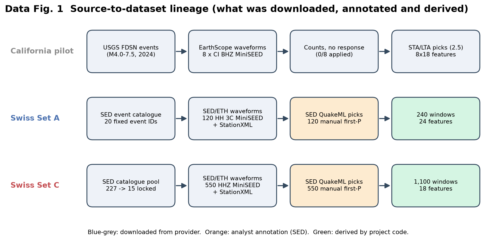

*Figure 1. How the data moves from the provider services to the two Swiss datasets and the derived model inputs. The California pilot is shown separately because it is not part of the Swiss ML evaluation.*

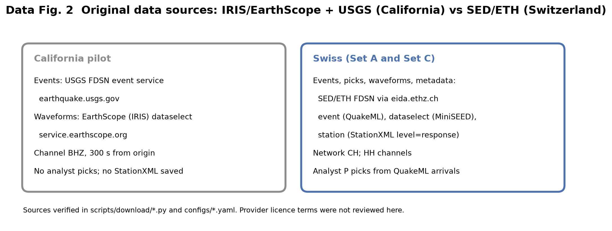

*Figure 2. Data sources used in the early California pilot and in the later Swiss experiments.*

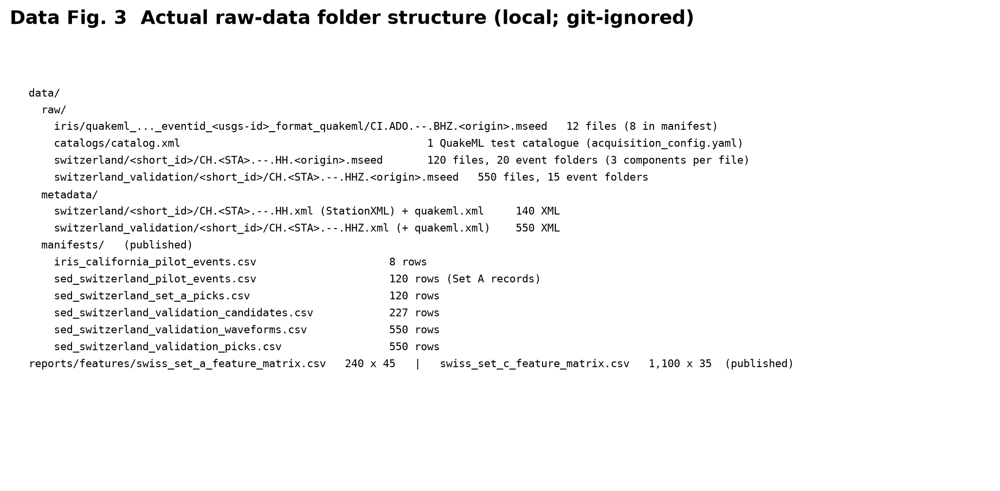

*Figure 3. Raw waveform and metadata file structure in the research working copy. Raw files are not included in the public Git repository.*

---

### 3.8 Window construction and labels

Each record contributes two four-second windows:

- **Positive window:** begins at the SED analyst first-P pick and extends four seconds after the pick.
- **Negative window:** begins 35 seconds before the event origin time and ends 31 seconds before origin time.

The positive class represents a pick-aligned P-wave candidate window; the negative class represents an earlier ambient-noise candidate window. The label column is `is_earthquake`, with positive windows labelled 1 and noise windows labelled 0.

The windows are labelled using analyst picks rather than the STA/LTA detector. This provides an independent reference for the window labels. An analyst pick is still an annotation and may carry uncertainty; it should not be described as error-free physical ground truth.

---

## 4. Data processing and feature engineering

The processing steps are shown here because the data is not given directly to the classifier as raw MiniSEED files. First the waveform is checked, then response correction and filtering are applied, and finally fixed windows and numerical features are prepared.

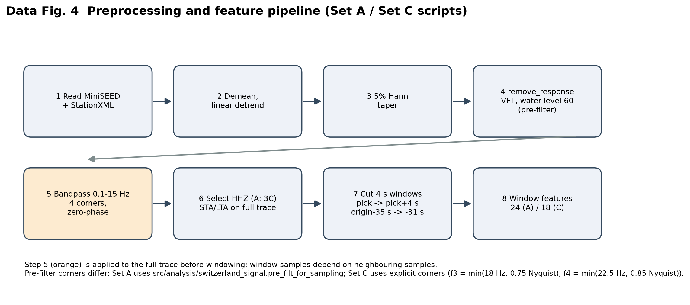

*Figure 4. Main processing stages used to prepare the Set A and Set C feature matrices. Some settings differ between the two datasets, as explained below.*

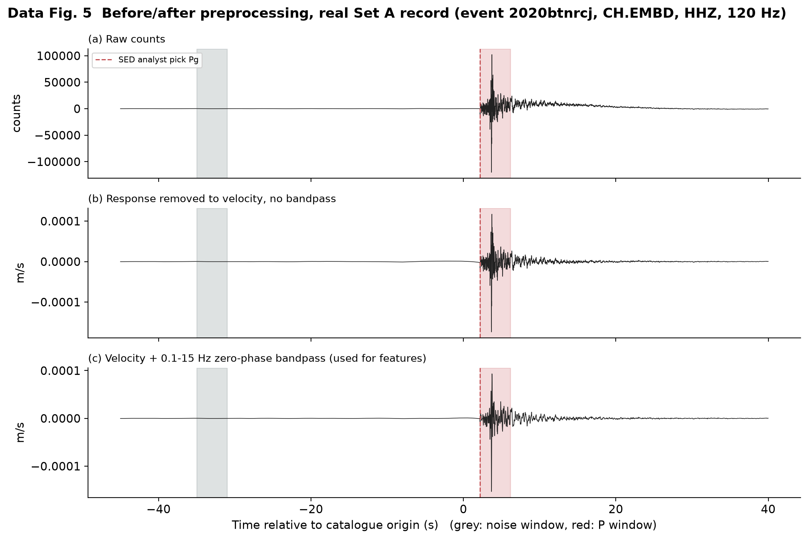

*Figure 5. Example Set A waveform at CH.EMBD (HHZ, 120 Hz), showing raw counts, response-corrected velocity and filtered velocity. The two shaded windows show the negative noise window and the positive P-wave window.*

### 4.1 Waveform validation and response correction

The Swiss records were checked for time coverage, gaps, overlaps, required channels and associated station metadata. The feature-processing summaries report zero failed records for both Set A and Set C. StationXML responses were used to remove instrument response and convert waveform amplitudes to ground velocity in metres per second.

### 4.2 Preprocessing

The documented processing sequence includes:

1. Demean the waveform.
2. Apply linear detrending.
3. Apply a 5% Hann taper.
4. Remove instrument response using `remove_response(output="VEL", water_level=60, zero_mean=True)` with a cosine pre-filter.
5. Apply a 0.1–15 Hz, four-corner Butterworth band-pass filter.

The band-pass operation is zero-phase and is applied to the full trace before the candidate windows are cut. This point is important: the placement of a window relative to a P pick does not make the complete processing pipeline causal. The current pipeline therefore does not establish a real-time processing implementation.

Two processing differences between Set A and Set C are documented. The STA window used to calculate `sta_lta_max` and `sta_lta_mean` is 0.5 seconds for Set A and 1.0 second for Set C. The response-removal pre-filter corner calculation also differs between the two scripts. The effects of these differences on Set C model performance have not been quantified.

### 4.3 Feature sets

The full Set A model schema contains 24 numeric features. These cover vertical waveform amplitude and shape, frequency-domain properties, horizontal and three-component properties, and STA/LTA or signal-to-noise measures.

Set C contains only HHZ records. To avoid inventing horizontal or three-component measurements, an 18-feature vertical-only schema was defined and trained on Set A. The 18 features include:

- Vertical amplitude and energy: peak velocity, peak-to-peak amplitude, RMS velocity, variance, standard deviation and integrated energy.
- Waveform shape: zero-crossing rate, crest factor, kurtosis and skewness.
- Cumulative absolute velocity field: `z_cav_m_s`.
- Spectral properties: dominant frequency, spectral centroid, spectral bandwidth, 95% spectral roll-off and spectral entropy.
- Traditional trigger measures: `sta_lta_max` and `sta_lta_mean`.

The saved field name `z_cav_m_s` is retained for schema compatibility. Its implementation is the sum of absolute velocity multiplied by the sample interval, which has the dimension of length, despite the field name. This naming issue is disclosed rather than silently changed.

Metadata and label columns are excluded from model inputs. In particular, event identifiers, station names, pick times, window type, origin times, magnitude and the target label are not used as predictive features.

---

## 5. Machine-learning methodology

The complete experiment is summarised in the next diagram. It shows the development data and the held-out event set separately. Set C is used only after the vertical models are trained and saved.

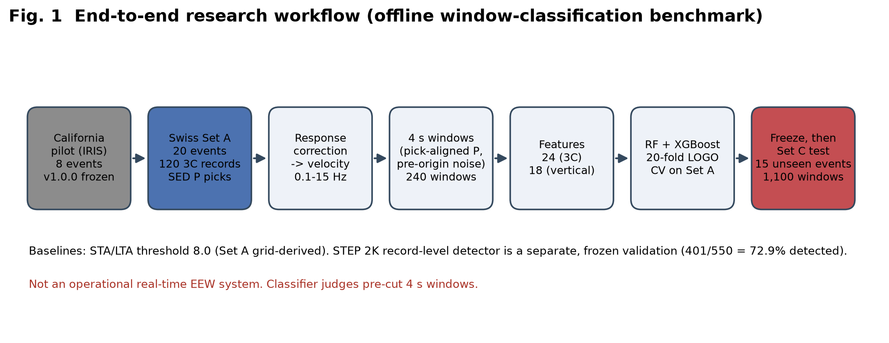

*Figure 6. Overall workflow from data acquisition to independent evaluation.*

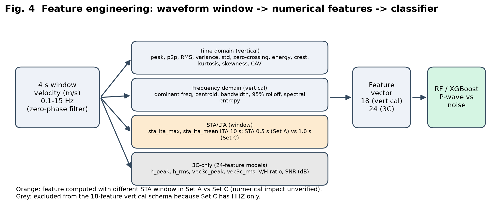

*Figure 7. A four-second waveform window is converted into numerical features before classification.*

### 5.1 Models

Two supervised tree-based classifiers were evaluated:

**Random Forest.** The documented configuration uses 200 trees, maximum depth 6, minimum split size 4, minimum leaf size 2, square-root feature subsampling, balanced class weights and random seed 42.

**XGBoost.** The documented configuration uses 100 estimators, maximum depth 4, learning rate 0.05, row subsampling 0.80, column subsampling 0.80, L1 regularisation 0.10, L2 regularisation 1.00 and random seed 42.

The repository does not document a broad model-selection study comparing many classifier families. These two models should therefore be described as the implemented tree-ensemble approaches, not as a proven optimal model selection.

### 5.2 Event-grouped cross-validation on Set A

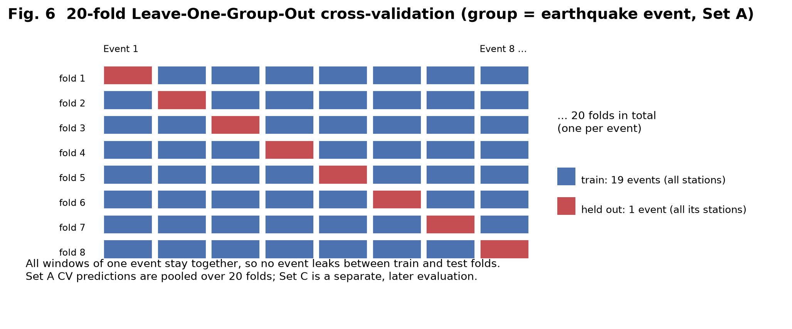

*Figure 8. Leave-One-Group-Out validation. One earthquake is kept for testing in each fold, rather than randomly splitting windows from the same event.*

Model development used 20-fold Leave-One-Group-Out (LOGO) cross-validation. The grouping variable is the earthquake identifier (`short_id`). In each fold, all windows from one earthquake are held out together while the other earthquakes are used for training. This prevents windows from the same event appearing in both training and test partitions within a fold.

The 24-feature models were evaluated in the ML-3 experiment. The vertical-only 18-feature models were separately evaluated in preparation for Set C, because Set C does not contain the horizontal components needed by the 24-feature schema.

### 5.3 Independent evaluation on Set C

The vertical-only Random Forest and XGBoost models were trained using Set A and then frozen. The feature schema, model parameters and decision boundary were not tuned on Set C. The frozen models were applied to the Set C feature matrix for one independent event-level evaluation.

Set C was not used for model training, model selection or threshold adjustment. The evaluation is nevertheless not station-independent, because the stations overlap between the two datasets.

### 5.4 STA/LTA comparison

The ML-4 comparison uses a window-level STA/LTA rule: a window is classified as positive when `sta_lta_max >= 8.0`. The threshold was selected from a Swiss Set A threshold grid, and project documents state that it was declared before Set C evaluation. The Git history does not independently establish the exact timing of that declaration.

This window-level rule is different from the separate STEP 2K record-level STA/LTA detector. The two procedures use different windowing/scoring definitions and STA settings; their results must not be merged into one baseline comparison.

### 5.5 Evaluation metrics

The positive class is the P-wave candidate window. The reported measures include accuracy, precision, recall (sensitivity), specificity, F1-score, ROC-AUC and confusion-matrix counts. For clarity:

- **Precision** measures the proportion of windows predicted as P-wave that are positive in the reference labels.
- **Recall** measures the proportion of reference P-wave windows classified as positive.
- **Specificity** measures the proportion of reference noise windows classified as noise.
- **F1-score** is the harmonic mean of precision and recall.
- **ROC-AUC** summarises ranking performance across classification thresholds.

These are window-classification metrics. They are not operational false-alert rates or event-detection rates.

---

## 6. Results

The results below are shown as tables and figures so that the main comparisons can be understood without opening the project website. The website is an additional place to explore the work, not a replacement for the report.

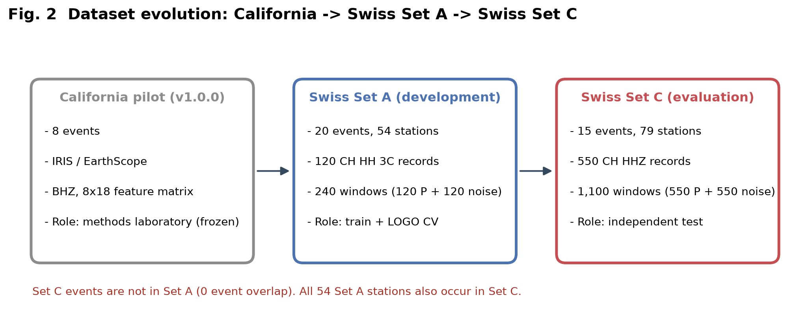

*Figure 9. Growth from the initial California pilot to Swiss Set A and Set C. The three stages have different roles and their results are not combined.*

### 6.1 Set A — 24-feature model evaluation

The ML-3 event-grouped cross-validation results for the 24-feature models were:

| Model / baseline | Accuracy | Precision | Recall | F1-score | ROC-AUC | FP | FN |
|---|---:|---:|---:|---:|---:|---:|---:|
| Random Forest, 24 features | 0.9917 | 1.0000 | 0.9833 | 0.9916 | 0.9990 | 0 | 2 |
| XGBoost, 24 features | 0.9833 | 0.9915 | 0.9750 | 0.9832 | 0.9990 | 1 | 3 |
| STA/LTA, threshold 8.0 | 0.9417 | 0.9907 | 0.8917 | 0.9386 | 0.9710 | 1 | 13 |

These values describe cross-validation on the Set A development dataset. They should not be presented as the independent Set C result.

### 6.2 Set A — vertical-only model evaluation

The 18-feature vertical-only models were also evaluated using 20-fold event-grouped LOGO cross-validation:

| Model | Accuracy | Precision | Recall | Specificity | F1-score | ROC-AUC |
|---|---:|---:|---:|---:|---:|---:|
| Random Forest, 18 features | 0.9792 | 0.9915 | 0.9667 | 0.9917 | 0.9789 | 0.9994 |
| XGBoost, 18 features | 0.9833 | 0.9915 | 0.9750 | 0.9917 | 0.9832 | 0.9984 |

This experiment established the vertical-only schema used for the independent Set C evaluation.

### 6.3 Set C — independent event evaluation

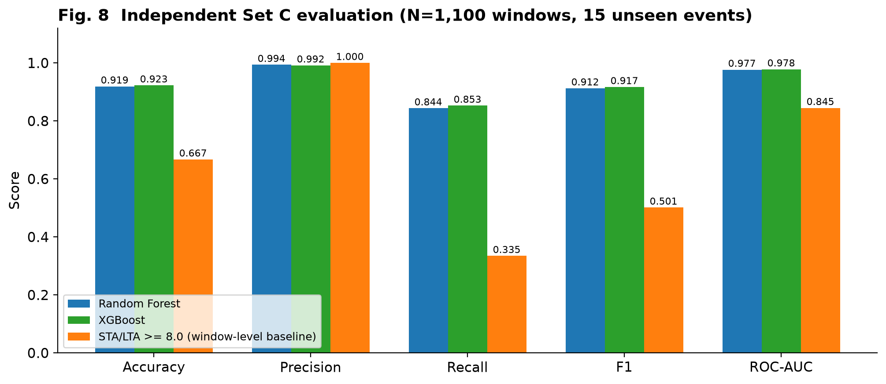

*Figure 10. Comparison of the frozen vertical models and the window-level STA/LTA baseline on Set C. See the table below for exact values.*

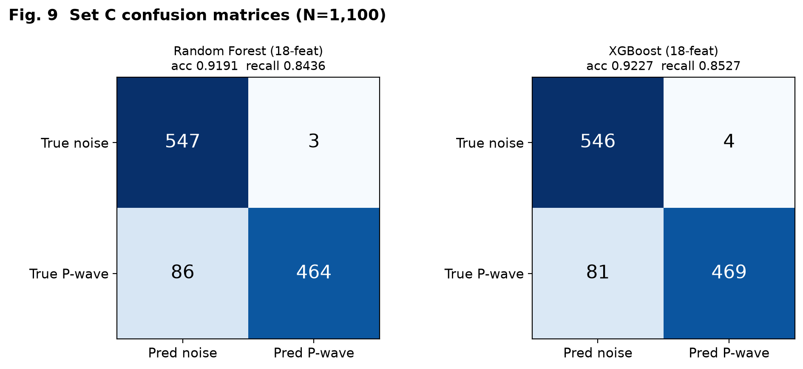

*Figure 11. Confusion matrices for the three methods on Set C. The counts are also listed in the table below.*

The principal result is the performance of the frozen 18-feature models on Set C:

| Model / baseline | Accuracy | Precision | Recall | Specificity | F1-score | ROC-AUC |
|---|---:|---:|---:|---:|---:|---:|
| XGBoost, vertical | 0.9227 | 0.9915 | 0.8527 | 0.9927 | 0.9169 | 0.9780 |
| Random Forest, vertical | 0.9191 | 0.9936 | 0.8436 | 0.9945 | 0.9125 | 0.9767 |
| STA/LTA window baseline | 0.6673 | 1.0000 | 0.3345 | 1.0000 | 0.5014 | 0.8448 |

The corresponding confusion-matrix counts are:

| Model / baseline | TP | FN | TN | FP |
|---|---:|---:|---:|---:|
| XGBoost, vertical | 469 | 81 | 546 | 4 |
| Random Forest, vertical | 464 | 86 | 547 | 3 |
| STA/LTA window baseline | 184 | 366 | 550 | 0 |

XGBoost achieved the highest recall and F1-score among the three methods in this evaluation. Random Forest had marginally higher precision and specificity. Both machine-learning models classified substantially more positive P-wave windows than the selected STA/LTA window rule, while producing a small number of false-positive noise windows.

Relative to the window-level STA/LTA baseline's 366 false negatives, XGBoost produced 81 false negatives, a reduction of 77.9%. Random Forest produced 86 false negatives, a reduction of 76.5%. These reductions apply to the defined Set C window-classification experiment only.

### 6.4 Per-event behaviour

Aggregate scores conceal variation between earthquakes. The Set C per-event results show weaker recall for some of the smallest events. For example, event `2020flmsvb` has recall of approximately 0.46 for Random Forest and 0.48 for XGBoost. The project analysis notes that missed windows were concentrated on distant stations for the smallest events, where P-wave amplitudes may approach the ambient noise level. This is a plausible interpretation of the observed pattern, not a separately proven causal explanation.

### 6.5 Feature importance

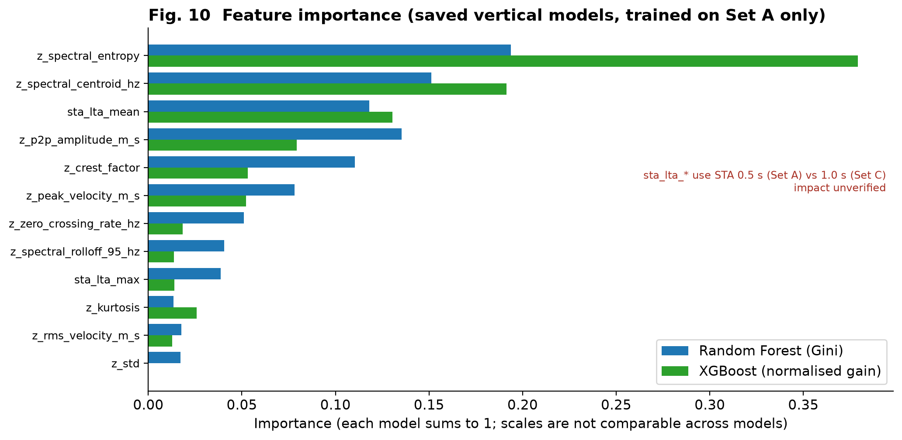

*Figure 12. Feature importance from the saved vertical models. Importance values show how the fitted models used the features; they do not prove physical causation.*

The saved vertical models identify spectral entropy and spectral centroid among the most influential features. For XGBoost, spectral entropy has the highest reported relative gain (0.3791), followed by spectral centroid (0.1913). For Random Forest, spectral entropy has the highest reported Gini importance (0.1937), followed by spectral centroid (0.1511).

These values describe how the fitted models used the input features. They do not establish that a feature is a physical cause of P-wave detection. The interpretation that spectral characteristics help distinguish coherent P-wave energy from background noise is consistent with the feature definitions, but requires further physical and statistical validation.

---

## 7. Discussion

The experiments show that, for the constructed four-second windows in the available Swiss datasets, Random Forest and XGBoost achieved higher recall and F1-score than the selected window-level STA/LTA threshold rule on Set C. The Set C precision and specificity values were also high, with three false positives for Random Forest and four for XGBoost among 550 labelled noise windows.

The independent Set C evaluation is an important step beyond reporting cross-validation scores on the development dataset. It tests the frozen vertical-only models on 15 earthquakes not included in Set A. The results therefore provide evidence of event-level generalisation within the available Swiss data. However, station overlap means that the evaluation does not establish generalisation to entirely unseen stations or networks.

The difference between Set A cross-validation F1-scores and Set C F1-scores should be treated as a finding requiring further investigation. The current repository does not establish a single cause. Candidate factors include event and distance distributions, station effects, the STA-window discrepancy, and the response pre-filter differences. A controlled harmonisation and sensitivity experiment would be needed before attributing the performance change to any one factor.

The study also demonstrates why the classification task must be stated precisely. Since positive windows begin at analyst picks, the models are distinguishing already aligned P-wave windows from earlier noise windows. This is not equivalent to finding the arrival time in a continuous trace. A practical EEW system would need causal streaming preprocessing, an arrival candidate-generation mechanism, latency measurement, false-alert evaluation over long noise periods, and tests across additional events and stations.

---

## 8. Limitations and threats to validity

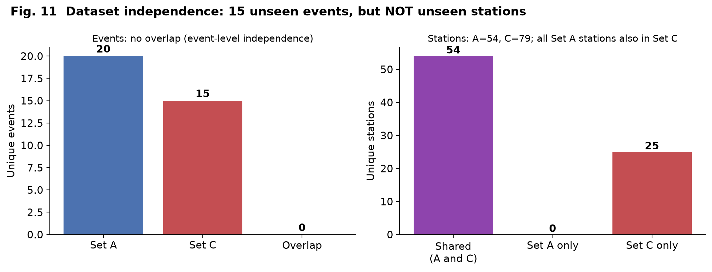

*Figure 13. Set A and Set C have different earthquake events, but their station coverage overlaps. This is why the evaluation is event-independent but not station-independent.*

The following limitations are part of the interpretation of the reported results.

1. **Limited number of independent earthquakes.** Set A contains 20 development events and Set C contains 15 evaluation events. The 240 and 1,100 windows are not independent earthquake samples. Confidence intervals are not reported in the current repository.
2. **Station overlap.** All 54 Set A stations also occur in Set C. The evaluation is event-independent, not station-independent.
3. **Vertical-only evaluation.** Set C contains HHZ records only. The 24-feature three-component models could not be evaluated directly without inventing missing horizontal features. The reported Set C results use the 18-feature vertical schema.
4. **Preprocessing differences.** The STA window differs between Set A and Set C (0.5 s versus 1.0 s), and response pre-filter corners differ. Their impact on the reported metrics is unknown.
5. **Non-causal filtering.** The zero-phase band-pass is applied to the full trace before window extraction. The current pipeline is not demonstrated to be suitable for real-time causal operation.
6. **Pick-aligned positive windows.** The positive samples begin at analyst first-P picks. The study therefore measures window discrimination rather than autonomous arrival-time detection or picking error.
7. **Noise-window contamination.** Negative windows are assumed to represent ambient noise. The processing code does not establish that every negative window is free of other seismic energy.
8. **Threshold provenance.** The threshold of 8.0 is documented as derived from a Set A threshold grid and pre-declared for Set C. Git history does not independently prove the timing of that declaration.
9. **Feature naming.** The saved `z_cav_m_s` field has a dimensional inconsistency between its name and implementation. It remains unchanged to preserve compatibility with the saved feature schema and models.
10. **No operational evaluation.** The work does not report continuous-stream detection, warning time, live false-alert rate, magnitude estimation, location estimation or performance across different seismic regions.
11. **Data selection documentation.** The reason for the original selection of the 20 Set A events and the exact ranking process that produced the final 15 Set C IDs are not fully documented.
12. **Data licensing and redistribution.** Provider licensing, attribution and redistribution terms have not been reviewed in the repository. Raw waveform and metadata files are not published there.

These limitations restrict the strength and scope of the conclusions. They do not invalidate the recorded window-level metrics, but they prevent those metrics from being interpreted as operational EEW performance.

---

## 9. Reproducibility and research artefacts

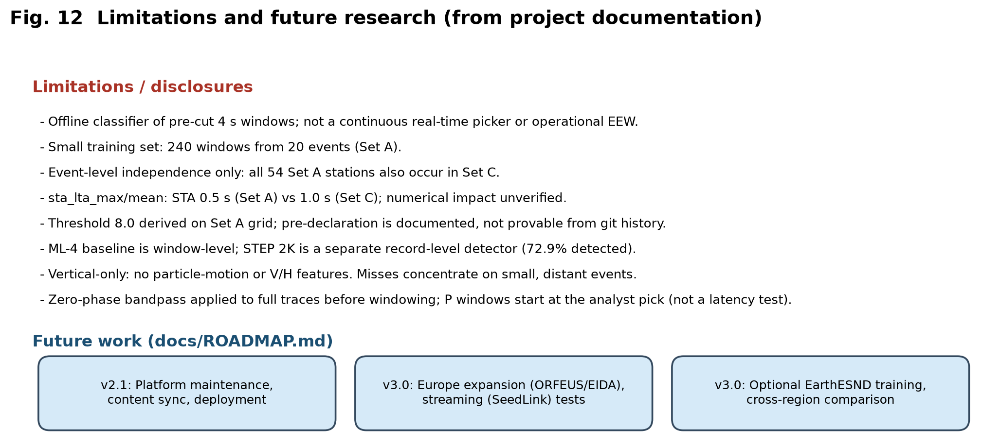

*Figure 14. Main research limitations and possible next steps.*

The repository contains scripts, configuration files, manifests, derived feature matrices, saved models, machine-readable evaluation summaries, figures, tests and methodological reports.

Key artefacts include:

- Data acquisition scripts under `scripts/download/`.
- Swiss feature extraction scripts under `scripts/analysis/`.
- Model implementations under `src/models/`.
- Training and evaluation scripts under `scripts/ml/`.
- Set A and Set C feature matrices under `reports/features/`.
- The vertical feature schema under `reports/ml/vertical_feature_schema.json`.
- Saved vertical models under `reports/ml/`.
- Evaluation summaries and per-event CSV files under `reports/ml/`.
- Detailed data and method descriptions under `docs/` and `docs/professor_handover/`.

The repository records a full automated test-suite result of 89 passing tests in the latest project status. This is a software verification result; it does not independently validate the scientific assumptions or establish operational readiness.

Raw MiniSEED, StationXML and QuakeML data are not published in the repository. Re-acquisition from data providers may differ as catalogues, picks, metadata and availability change. The data acquisition and reproduction guide should be followed when reproducing the workflow.

---

## 10. Conclusion

This research developed a reproducible workflow for constructing labelled seismic candidate windows, extracting waveform features and evaluating supervised classifiers with earthquake-event grouping. The work progressed from a small California data-processing pilot to a Swiss SED study with a development dataset and a separate event-level evaluation dataset.

On Swiss Set C, the frozen vertical XGBoost model achieved an F1-score of 0.9169 and recall of 0.8527. The vertical Random Forest model achieved an F1-score of 0.9125 and recall of 0.8436. Both exceeded the selected window-level STA/LTA baseline on recall and F1-score for this specific experiment. XGBoost produced 81 false-negative P-wave windows compared with 366 for the baseline.

The findings support the use of supervised tree-based models for further investigation of P-wave candidate-window classification. They do not yet establish a real-time P-wave detector or an operational EEW system. The small number of independent events, shared stations, pick-aligned windows, non-causal filtering and preprocessing differences must be addressed in future work.

The main contribution of this project is the complete data-to-model workflow and its evaluation on separate earthquake events. The report also records the points which are still not tested and should be improved in the next stage.

---

## 11. Future work

The following items are proposed and have not been completed in the reported experiments:

1. Harmonise the Set A and Set C preprocessing configurations and quantify the effect on model performance.
2. Replace full-trace zero-phase filtering with a causal streaming-compatible filter and repeat the evaluation.
3. Acquire additional independent earthquakes and stations, including a station-held-out evaluation design.
4. Obtain three-component Set C records and evaluate the 24-feature models on a compatible feature set.
5. Check negative windows for contamination by other seismic phases or events.
6. Report uncertainty intervals and assess performance at event level as well as window level.
7. Evaluate continuous waveform streams and measure detection latency, warning-time potential and false alerts over long background periods.
8. Extend the workflow to additional seismic regions and European network data where data access, station metadata and licensing permit.
9. Consider waveform-based deep-learning models only when the available event-level sample size and validation design can support them.

---

## 12. References and source records

### Scientific references already cited in the project

- Allen, R. M., and Kanamori, H. (2003). “The potential for earthquake early warning in southern California.” *Science*, 300(5620), 786–788. https://doi.org/10.1126/science.1080532
- Hoshiba, M., et al. (2008). “Outline of the 2007–2008 earthquake early warning experiments in Japan.” *Earth, Planets and Space*, 60, 123–129. https://doi.org/10.1186/BF03352879
- Krischer, L., et al. (2015). “ObsPy: A bridge for earthquake science.” *Seismological Research Letters*, 86(3), 765–771. https://doi.org/10.1785/0220150032

### Primary project evidence

The following repository records support the experimental design, data lineage, metrics and limitations described in this draft:

- `docs/DATA_COLLECTION_AND_ANALYSIS_REPORT.md`
- `docs/ML_RESULTS_REPORT.md`
- `docs/SET_C_VERTICAL_ML_EVALUATION_REPORT.md`
- `docs/professor_handover/RESEARCH_EXECUTIVE_SUMMARY.md`
- `docs/professor_handover/RESEARCH_METHODOLOGY.md`
- `docs/professor_handover/RESEARCH_LIMITATIONS_AND_OPEN_QUESTIONS.md`
- `docs/DATA_DICTIONARY.md`
- `docs/DATA_ACQUISITION_AND_REPRODUCTION.md`
- `FINAL_INTEGRITY_CHECK.md`

**Bibliography note:** The external reference list above is intentionally limited to scientific references already present in the earlier project report. Full citations for SED/EIDA, USGS, EarthScope and any additional ML methods should be checked against the exact provider and software documentation used before final submission.

---

## Appendix A — Key dataset and evaluation counts

| Item | Set A | Set C |
|---|---:|---:|
| Events | 20 | 15 |
| Records | 120 | 550 |
| Stations | 54 | 79 |
| Positive windows | 120 | 550 |
| Negative windows | 120 | 550 |
| Total windows | 240 | 1,100 |
| Model features | 24 full / 18 vertical | 18 vertical |
| Shared event IDs | 0 | 0 |
| Shared stations | — | 54 of 54 Set A stations |

## Appendix B — Set C confusion-matrix summary

| Method | TP | FN | TN | FP |
|---|---:|---:|---:|---:|
| XGBoost (vertical) | 469 | 81 | 546 | 4 |
| Random Forest (vertical) | 464 | 86 | 547 | 3 |
| STA/LTA window baseline | 184 | 366 | 550 | 0 |

## Appendix C — Important terminology

- **Record:** A waveform recording from a station for an earthquake.
- **Window:** A four-second segment extracted from a record.
- **Event-grouped cross-validation:** All windows associated with one earthquake are held out together in a fold.
- **Event-independent evaluation:** The evaluation earthquake IDs do not occur in the model-development dataset.
- **Station-independent evaluation:** Evaluation stations are not present in model development. This condition is not met in the current Set A/Set C experiment.
- **Window-level baseline:** A threshold applied to each constructed four-second window; distinct from the STEP 2K record-level detector.
- **Offline candidate-window classification:** Classification of windows that have already been extracted and aligned; not continuous-stream arrival detection.
